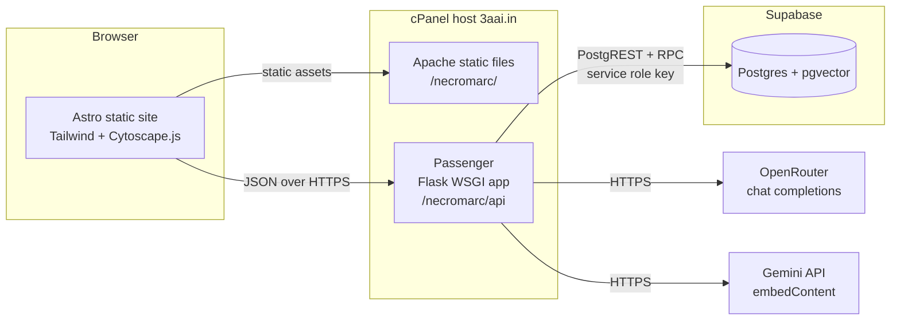
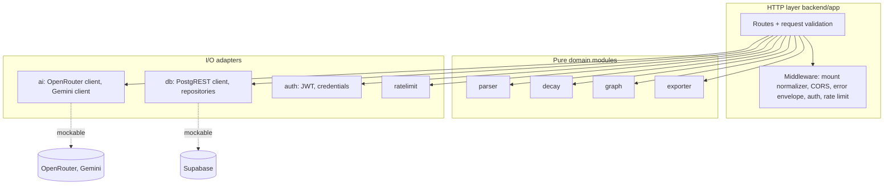
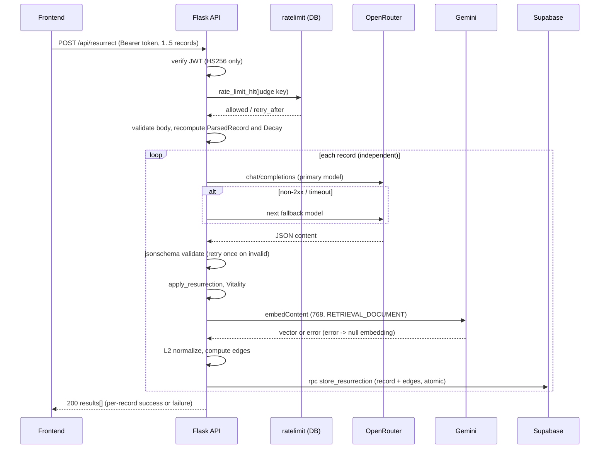
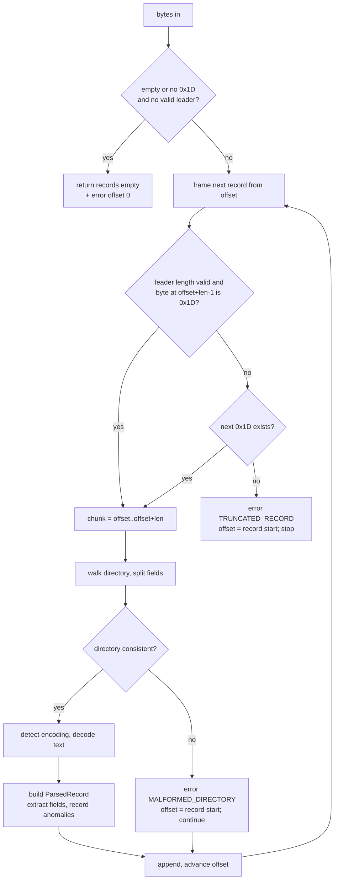
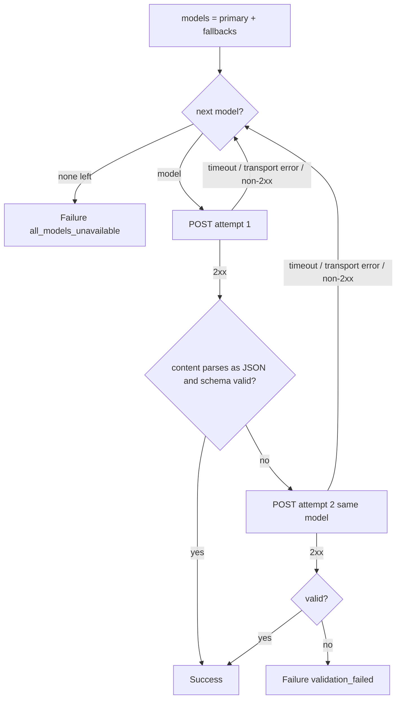
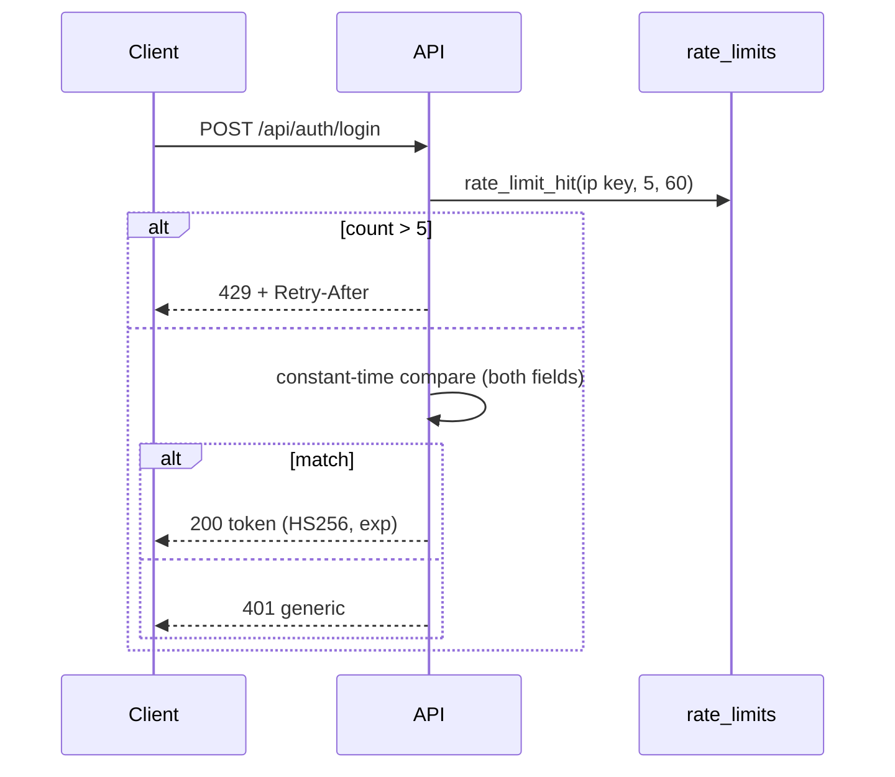
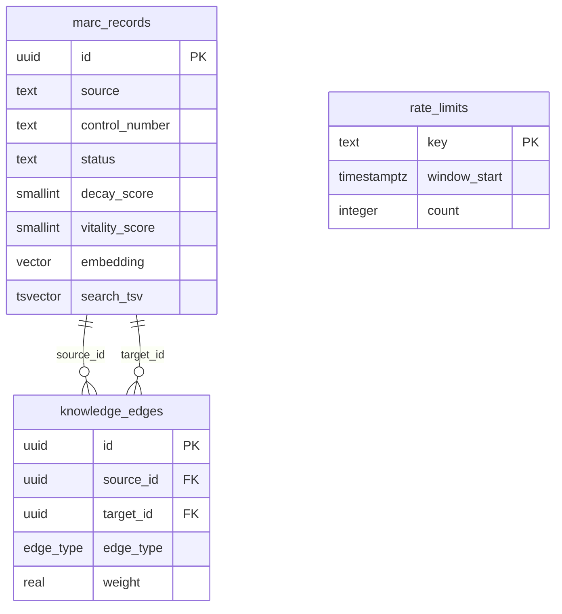
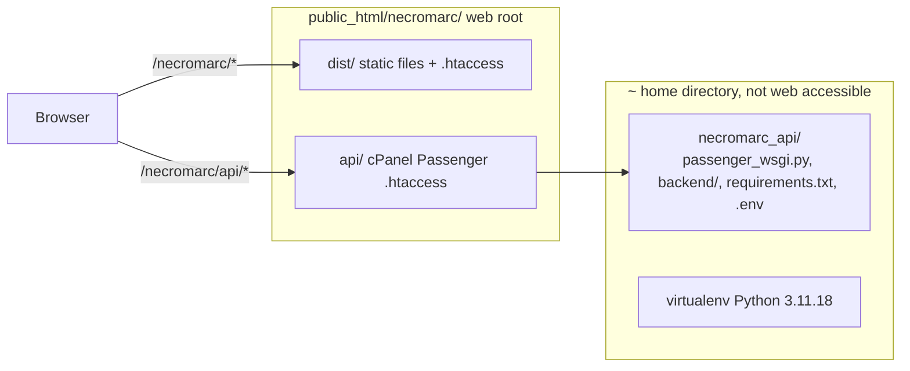

# Design Document

## Overview

NecroMARC is a Kiroween 2026 (Resurrection category) application that ingests raw or corrupted ISO 2709 `.mrc` files, scores their decay deterministically, heals and enriches them with an OpenRouter LLM, embeds them with Gemini, stores them in Supabase (Postgres + pgvector), and presents them in a bilingual (English/Arabic) Dark-Academia web interface with a Cytoscape.js knowledge graph.

MARC 21 is an actively maintained Library of Congress standard. The problem addressed is the 1960s ISO 2709 binary container: unindexed silos, broken encodings, missing summaries (520), and no Linked Open Data (BIBFRAME / JSON-LD).

### Design goals

1. **Deterministic core, probabilistic edge.** Parsing, decay scoring, normalization, edge computation, export, authentication, and rate limiting are pure or database-atomic and property-testable. The LLM and embedding calls are isolated behind narrow, mockable clients with strict output validation.
2. **Shared-hosting friendly.** One Flask WSGI app under Passenger (Python 3.11), a fully static Astro frontend, and Supabase as the only stateful service. No local ML, no background workers, no server-side sessions.
3. **Least privilege.** The browser never sees Supabase. All writes use the service role key held only in server Config. Row level security is enabled everywhere, and the public may only `SELECT` two tables.
4. **Cost protection.** Anything that spends LLM or embedding credits requires a Judge token and passes a database-backed fixed-window rate limiter.

### Key design decisions

| # | Decision | Rationale |
|---|----------|-----------|
| D1 | The backend talks to Supabase through PostgREST using `httpx` and does not use `supabase-py`. | `supabase-py` pulls `postgrest` and `pydantic`, which depends on `pydantic-core` (Rust). Requirement 17.4 forbids native packages. |
| D2 | `jsonschema` is pinned to `4.17.3`, with `pyrsistent` installed from its `py3-none-any` wheel. | `jsonschema >= 4.18` depends on `referencing` and `rpds-py` (Rust). Verified on PyPI: `pyrsistent 0.20.0` publishes a `py3-none-any` wheel, and `rpds-py` does not. Hash-pinned requirements force pip to select the pure wheel. |
| D3 | `pymarc` supplies the record model, MARC-8 codec, and MARCXML writer. A small in-house ISO 2709 splitter and directory walker does framing and encoding detection. | Requirement 1 needs byte offsets, per-record error isolation, and encoding anomaly reporting, which pymarc's reader does not expose. |
| D4 | Resurrection result, record row, and edges are written by one Postgres function (`store_resurrection`) in one transaction. | Requirement 3.7 (atomic write) and 5.9 (edge canonicalization enforced in SQL). |
| D5 | Rate limiting uses one `INSERT ... ON CONFLICT DO UPDATE` statement wrapped in a SQL function. | Requirement 9.12: N concurrent requests increase the counter by exactly N. The row lock taken by `ON CONFLICT` serializes updates. |
| D6 | The API recomputes every derived value (decay, extracted fields) from `leader` + `fields`. It never trusts client-supplied derived data. | Prevents score forgery and keeps one source of truth. |
| D7 | The WSGI entry point normalizes Passenger's `SCRIPT_NAME` so the routes are always `/api/...`. | Requirement 17.7 and 17.9 hold whether cPanel mounts the app at `/necromarc` or at `/necromarc/api`. |
| D8 | Embedding task types: `RETRIEVAL_DOCUMENT` for stored records, `RETRIEVAL_QUERY` for free-text search. | Gemini recommends asymmetric task types for retrieval quality. Dimension and normalization are unchanged. |
| D9 | The Gemini model is `gemini-embedding-001` (768 dimensions) from the approved Requirement 4. | The steering file mentions `text-embedding-004`. The approved requirements take precedence. The steering note should be updated. |

### Open issues found while designing (none block design)

| ID | Issue | Proposed handling in this design |
|----|-------|----------------------------------|
| O1 | Requirement 19.4 wants hook failure output visible, but a `PostFileSave` command hook only forwards stdout for some triggers. | The command is wrapped to also write `.kiro/hooks/last-run.log`. A companion `agent` hook may be added if the runner does not surface output. |
| O2 | Requirement 9.4 does not give the status code for a fully failed batch. | HTTP 502 with code `BATCH_FAILED` and the per-record results attached. |
| O3 | Requirement 15.1 sources: exact Project Gutenberg and LoC SRU endpoints are not fixed in the requirements. | Config variables `GUTENBERG_MARC_URL_TEMPLATE` and `LOC_SRU_URL`. Endpoints are confirmed during implementation. |

## Architecture

### System context



### Backend layering



Domain modules import nothing from adapters or Flask. This keeps Hypothesis tests fast and network free.

### Resurrection flow



### Parser flow



Encoding detection (per record):

1. If every byte is below 0x80, the text is ASCII and no encoding anomaly is possible.
2. If the bytes decode as strict UTF-8, the detected encoding is `utf-8`.
3. Otherwise, if Leader/09 is blank (MARC-8 declared) or the data has ESC (0x1B) sequences, convert with `pymarc.marc8` and accept the result when it contains no U+FFFD. If conversion fails, fall back to Latin-1 (`iso-8859-1`), which decodes any byte.
4. Otherwise (declared `a` but invalid UTF-8), try Latin-1.
5. If the detected encoding differs from the declared one, add `ENCODING_MISMATCH` carrying both names. If the chosen decoder had to substitute bytes, replace them with U+FFFD and add `ENCODING_UNDECODABLE`.

### Backend module layout

```
passenger_wsgi.py              # exposes `application`
requirements.txt               # hash-locked, every entry pinned with ==
requirements-dev.txt
scripts/
  check_deps.py                # forbidden / unpinned / non-pure package check
  native_allowlist.txt         # reviewed exceptions (reviewed allowlist, prebuilt-wheel packages only)
  secret_scan.py               # tracked-file secret scan
  run_parser_tests.sh          # wrapper used by the Kiro hook
backend/
  app/
    __init__.py                # create_app(settings), create_app_from_env()
    config.py                  # Settings dataclass, load_settings(), ConfigError
    errors.py                  # ApiError, error envelope, handlers
    logging_utils.py           # SecretRedactingFilter
    mount.py                   # MountNormalizer WSGI middleware
    cors.py
    routes/
      auth.py records.py graph.py search.py upload.py resurrect.py samples.py health.py
    schemas/                   # JSON Schema dicts + validate() helpers
  parser/
    iso2709.py                 # framing, directory walk, offsets
    encoding.py                # detect + decode, anomalies
    model.py                   # ParsedRecord, Field, Anomaly, ParseError, ParseResult
    extract.py                 # field extraction (leader/008 positions)
    printer.py                 # Pretty_Printer (ParsedRecord -> ISO 2709)
  decay/
    rules.py                   # five rules, calculate_decay()
    vitality.py                # apply_resurrection(), vitality_score()
  ai/
    openrouter.py              # OpenRouterClient, fallback + retry flow
    prompts.py                 # prompt builder
    resurrection_schema.py     # build_resurrection_schema(current_year)
    embeddings.py              # GeminiEmbeddingClient, build_embedding_input, l2_normalize
  exporter/
    marc.py marcxml.py jsonld.py provenance.py
  graph/
    normalize.py               # normalize_text, extract_year
    edges.py                   # compute_edges (pure), canonical_pair
    elements.py                # build_cytoscape_elements
  db/
    client.py                  # PostgrestClient (httpx), DatabaseUnavailable
    records.py edges.py        # repositories
  auth/
    credentials.py             # constant-time check
    tokens.py                  # issue_token, verify_token (HS256 only)
    decorators.py              # judge_required
  ratelimit/
    limiter.py                 # RateLimiter.hit(key) -> RateDecision
  samples/tomb.mrc             # Sample_Tomb (<= 5 records)
  scripts/seed/
    __main__.py                # `python -m backend.scripts.seed`
    sources.py synthetic.py report.py   # synthetic 'truncated record' = truncated field content, valid ISO 2709 framing
  tests/                       # pytest + Hypothesis (see Testing Strategy)
supabase/migrations/           # versioned SQL (see Data Models)
frontend/                      # Astro project (see Frontend Design)
docs/ mcp.md deployment.md
.kiro/ specs/ steering/ hooks/
```

### Configuration validation (startup)

`load_settings(env: Mapping[str, str]) -> Settings` collects every problem before failing, so one run reports all of them. `ConfigError.problems` holds names and rules only, never values.

| Variable | Rule |
|----------|------|
| `JUDGE_USERNAME`, `JUDGE_PASSWORD`, `JWT_SECRET_KEY` | required, non-empty (7.5) |
| `JUDGE_PASSWORD` | length >= 16 and not equal to `JUDGE_USERNAME` (7.4) |
| `JWT_SECRET_KEY` | length >= 32 (7.6) |
| `JUDGE_TOKEN_TTL_SECONDS` | integer in 60..86400, default 3600 (7.1) |
| `SUPABASE_URL`, `SUPABASE_SERVICE_ROLE_KEY`, `OPENROUTER_API_KEY`, `OPENROUTER_MODEL`, `GEMINI_API_KEY` | required, non-empty |
| `OPENROUTER_FALLBACK_MODELS` | comma separated, may be empty |
| `GEMINI_EMBEDDING_MODEL` | default `gemini-embedding-001` |
| `CORS_ORIGINS` | comma separated absolute origins, `*` rejected (17.11) |
| `MAX_UPLOAD_BYTES` | default 5242880 |
| `DEFAULT_PAGE_SIZE` / `MAX_PAGE_SIZE` | defaults 20 / 50, default <= max |
| `RATE_LIMIT_REQUESTS` / `RATE_LIMIT_WINDOW_SECONDS` | defaults 30 / 60 |
| `LOGIN_MAX_ATTEMPTS` / `LOGIN_WINDOW_SECONDS` | defaults 5 / 60 |
| `SIMILARITY_THRESHOLD` | float in [0.5, 1.0], default 0.75 (SEMANTIC_SIMILARITY edges) |
| `SEMANTIC_EDGE_MAX` | default 1000 |
| `SEED_WAIT_SECONDS`, `SEED_QUOTA_GUTENBERG`, `SEED_QUOTA_LOC`, `SEED_QUOTA_SYNTHETIC`, `SYNTHETIC_SEED`, `GUTENBERG_MARC_URL_TEMPLATE`, `LOC_SRU_URL` | seed script only (15.4) |
| `PUBLIC_BASE_PATH`, `PUBLIC_API_URL` | frontend build only |
| `PUBLIC_RESURRECT_TIMEOUT_MS` | frontend build only, default 120000 (11.10) |

`passenger_wsgi.py` catches `ConfigError`, writes `ConfigError.problems` to stderr, and calls `sys.exit(1)`.

The `SecretRedactingFilter` is attached to the root logger. It replaces every occurrence of each secret Config value (service role key, OpenRouter key, Gemini key, judge password, JWT secret) with `[REDACTED]` in log messages and exception text (3.9, 18.12). Error responses never include upstream response bodies or exception strings.

### Dependency constraints

Runtime packages (versions are pinned and hash-locked at implementation; indicative versions were checked on PyPI):

| Package | Purpose | Native code? |
|---------|---------|--------------|
| Flask 3.1, Werkzeug, Jinja2, itsdangerous, click, blinker | HTTP | `MarkupSafe` only (allowlisted) |
| pymarc 5.4 | MARC model, MARC-8, MARCXML | no |
| httpx 0.28 (+ httpcore, h11, anyio, sniffio, idna, certifi) | OpenRouter, Gemini, PostgREST | no |
| PyJWT 2.x | HS256 tokens (no `cryptography` needed) | no |
| jsonschema 4.17.3 + pyrsistent 0.20.0 + attrs | request and LLM validation | pure wheel only (D2) |
| python-dotenv | local `.env` loading | no |

Dev only: pytest, hypothesis, respx.

Flask is kept. `MarkupSafe` is the only dependency that is not a pure-Python wheel, and it ships prebuilt binary wheels that need no compilation at install time. `scripts/native_allowlist.txt` is a reviewed allowlist that initially contains only `MarkupSafe`, and only packages with prebuilt binary wheels may be added (17.4). Allowlisted packages are never flagged by the dependency check.

`scripts/check_deps.py` algorithm:

1. Parse `requirements.txt`. Any entry without `==` is reported as unpinned.
2. Resolve the transitive set from the installed environment (`importlib.metadata`) or from `pip install --dry-run --report`.
3. Report any package whose normalized name is in `{ollama, torch, pytorch, tensorflow, transformers, sentence-transformers, pydantic-core}`. This check applies even if a package were listed in the allowlist.
4. For each installed distribution, read `*.dist-info/WHEEL`. Report it as non-pure unless `Root-Is-Purelib: true` and a tag of `py3-none-any`, except names listed in `native_allowlist.txt`, which are skipped by this step only.
5. Print each offending package name (forbidden, unpinned, or non-allowlisted native) and exit non-zero if any were found.

`scripts/secret_scan.py` runs `git ls-files`, then scans each file for `sk-or-`, `AIza`, `eyJ` and for `KEY=value` assignments to secret Config names whose value is not an obvious placeholder (`changeme`, `your-...-here`, `<...>`, empty). It also verifies that `.env.example` has every variable from Requirement 18.2. Output lists `path:line` and the rule name, never the matched text. Exit is 0 when clean.

## Components and Interfaces

### Parser (`backend/parser`)

```python
@dataclass(frozen=True)
class Anomaly:  kind: Literal["encoding", "structural"]; code: str; message: str; tag: str | None

@dataclass(frozen=True)
class Subfield: code: str; value: str

@dataclass(frozen=True)
class Field:                       # control field: data set; data field: ind1/ind2/subfields set
    tag: str; data: str | None = None
    ind1: str = " "; ind2: str = " "; subfields: tuple[Subfield, ...] = ()
    ai: bool = False               # True only for values written by the Resurrection_Engine

@dataclass(frozen=True)
class ParsedRecord:
    leader: str | None; fields: tuple[Field, ...]; anomalies: tuple[Anomaly, ...]
    byte_offset: int; detected_encoding: str | None
    # derived (computed by extract.py, never client supplied):
    control_number: str | None; leader_status: str | None; leader_type: str | None; leader_bib_level: str | None
    pub_year_008: str | None; place_code_008: str | None; language_code_008: str | None
    isbns: tuple[str, ...]; authors: tuple[Author, ...]            # 100 $a $d
    titles: tuple[Title, ...]; publications: tuple[Publication, ...]  # 245, 260/264
    notes: tuple[str, ...]; summaries: tuple[str, ...]; subjects: tuple[Subject, ...]  # 500, 520, 650

@dataclass(frozen=True)
class ParseError: code: str; message: str; byte_offset: int
@dataclass(frozen=True)
class ParseResult: records: tuple[ParsedRecord, ...]; errors: tuple[ParseError, ...]

def parse_iso2709(data: bytes) -> ParseResult        # total: never raises
def print_iso2709(record: ParsedRecord) -> bytes     # Pretty_Printer
def build_parsed_record(leader, fields, anomalies, byte_offset=0) -> ParsedRecord  # recompute derived values
```

Rules:

* Absent fields and subfields are `None` or empty tuples, never `""` (1.2). Repeatable fields keep input order.
* Leader positions 05-07 are read when `len(leader) >= 24`. 008 positions 07-10, 15-17, 35-37 are read when `len(f008) == 40`. Otherwise those values are `None` and a structural anomaly with `tag` is recorded (1.5).
* Error codes: `EMPTY_INPUT`, `NO_RECORD`, `TRUNCATED_RECORD`, `MALFORMED_LEADER`, `MALFORMED_DIRECTORY`, `BAD_FIELD_TERMINATOR`. `byte_offset` is the zero-based start of the affected record (0 for empty input).
* `parse_iso2709` wraps each record in a `try/except Exception` that converts any unexpected failure into `ParseError("INTERNAL_PARSE_FAILURE", ...)`. Together with a bounded loop (each iteration advances the offset by at least one byte), this guarantees totality and termination for inputs of 0 to 100 MB or more (1.11). Memory is bounded by streaming records out of a `memoryview`.
* `print_iso2709` always encodes UTF-8, sets Leader/09 to `a`, recomputes record length (positions 00-04) and base address (12-16), writes a 12-byte directory entry per field (3-character tag, 4-digit field length, 5-digit start offset), appends `0x1E` after every field and directory, and ends with `0x1D`. If the record would exceed 99,999 bytes or a field exceeds 9,999 bytes it raises `RecordTooLarge` (the only exception in the module; the exporter maps it to HTTP 422).

### Decay calculator (`backend/decay`)

```python
RULES = (                      # order is the breakdown order (2.8)
  ("missing_520", 30), ("missing_650", 25), ("invalid_year", 20),
  ("missing_100d", 15), ("anomaly", 10))                # sum = 100

@dataclass(frozen=True)
class DecayEntry: rule: str; points: int
@dataclass(frozen=True)
class DecayResult: score: int; breakdown: tuple[DecayEntry, ...]

def calculate_decay(rec: ParsedRecord, current_year: int) -> DecayResult   # total, pure
def vitality_score(healed: ParsedRecord, current_year: int) -> int          # 100 - calculate_decay(healed).score
```

Rule predicates (each applied at most once):

| Rule | Fires when |
|------|-----------|
| `missing_520` | no field with tag 520 |
| `missing_650` | no field with tag 650 |
| `invalid_year` | no 008, `len(008) < 11`, or `008[7:11]` does not match `^[0-9]{4}$` with `1000 <= int <= current_year + 1` (ASCII digits only: `re.fullmatch(r"[0-9]{4}", s)` so Unicode digits fail) |
| `missing_100d` | no 100 field has a `$d` with a non-whitespace character |
| `anomaly` | at least one anomaly of kind `encoding` or `structural` |

`current_year` is injected, never read inside the function, so the function is deterministic (2.9). The route layer passes `datetime.now(timezone.utc).year`. A parsed record that carried structured parse errors (2.10) is evaluated with absent fields treated as missing.

`apply_resurrection(rec, result, current_year) -> HealedRecord` returns the healed record, which is a `ParsedRecord` with `Field.ai=True` on every AI-written field:

* 520: when the original has none, add `520 ## $a healed_summary` (never overwrites an original 520).
* 650: for each inferred subject whose normalized form is not already present, append `650 #4 $a subject` (ind2 `4` = source not specified).
* Year: if the 008 year is invalid, the healed 008 carries `normalized_year` at positions 07-10. If 008 is absent, a 40-character 008 is synthesized with `000000` entered date, the year, fill characters `|`, and the language code unknown (`|||`). This makes `invalid_year` evaluate against the healed value, as Requirement 2.11 requires.
* Anomalies: encoding anomalies of code `ENCODING_MISMATCH` are resolved by healing (text is now Unicode). `ENCODING_UNDECODABLE` and structural anomalies are retained.
* `100 $d` cannot be inferred (not in the LLM schema), so a record lacking it has a maximum Vitality_Score of 85. This is intentional.

### AI: OpenRouter client (`backend/ai/openrouter.py`)

```python
class OpenRouterClient:
    def __init__(self, api_key, model, fallback_models, http: httpx.Client, current_year: Callable[[], int]): ...
    def resurrect(self, rec: ParsedRecord) -> ResurrectionOutcome   # never raises
# ResurrectionOutcome = Success(result: dict, model: str) | Failure(reason: "validation_failed" | "all_models_unavailable")
```

Request (one POST per attempt, `httpx.Timeout(30.0)` plus a monotonic 30 s wall-clock guard on the response read):

```json
{
  "model": "<model>",
  "temperature": 0.2,
  "response_format": {"type": "json_object"},
  "messages": [
    {"role": "system", "content": "You are a rare-books cataloguer. Reply with ONE JSON object and nothing else. Keys: healed_summary (50-1000 chars, factual, no invented quotations), inferred_subjects (3-5 unique topical terms, each <= 100 chars), normalized_year (integer 1000..<current_year>), language_name (English name of the language for the 008/35-37 code, <= 50 chars), json_ld (schema.org Book with @context https://schema.org and @type Book). Never add other keys. If unsure, give the most conservative value."},
    {"role": "user", "content": "<compact JSON of title, subtitle, responsibility, author, dates, publication, ISBN, 008 language code, notes, existing subjects>"}
  ]
}
```

Headers: `Authorization: Bearer <key>`, `Content-Type`, `HTTP-Referer` (site URL), `X-Title: NecroMARC`. The key comes only from Config. The user message contains record data only and is treated as data by the system prompt, so imperative text inside a catalogue record cannot change the output schema (and the output is schema-validated regardless).

Attempt flow:



Decisions: validation failure after one retry ends the flow (3.6) and does not consult fallback models. A transport failure on the retry counts as a model failure and moves to the next model. Content extraction strips a surrounding Markdown code fence before `json.loads`. The LLM `json_ld` is sanitized by an allow-list of schema.org Book keys before storage.

Resurrection_Result JSON Schema (built per call by `build_resurrection_schema(current_year)`; draft-07):

```json
{
  "$schema": "http://json-schema.org/draft-07/schema#",
  "type": "object",
  "additionalProperties": false,
  "required": ["healed_summary", "inferred_subjects", "normalized_year", "language_name", "json_ld"],
  "properties": {
    "healed_summary": {"type": "string", "minLength": 50, "maxLength": 1000},
    "inferred_subjects": {
      "type": "array", "minItems": 3, "maxItems": 5, "uniqueItems": true,
      "items": {"type": "string", "minLength": 1, "maxLength": 100, "pattern": "\\S"}
    },
    "normalized_year": {"type": "integer", "minimum": 1000, "maximum": 2026},
    "language_name": {"type": "string", "minLength": 1, "maxLength": 50, "pattern": "\\S"},
    "json_ld": {
      "type": "object",
      "required": ["@context", "@type"],
      "properties": {"@context": {"const": "https://schema.org"}, "@type": {"const": "Book"}}
    }
  }
}
```

`maximum` is the injected current year (2026 shown as example). A Python-level check additionally rejects floats such as `1990.5` (jsonschema accepts `1990.0` as an integer in draft 7, which is acceptable).

### AI: Gemini embedding client (`backend/ai/embeddings.py`)

```python
def build_embedding_input(title, author, healed_summary, subjects: Sequence[str]) -> str
def l2_normalize(v: Sequence[float]) -> list[float]        # raises ZeroVectorError for the zero vector
class GeminiEmbeddingClient:
    def embed(self, text: str, task: Literal["RETRIEVAL_DOCUMENT", "RETRIEVAL_QUERY"]) -> EmbeddingOutcome  # never raises
```

* **Input composition (4.2-4.3):** parts `[title, author, healed_summary, ", ".join(subjects)]`, each stripped, empty parts omitted, joined with a single `"\n"`, then truncated to the first 8,000 characters.
* **Empty input (4.4):** if no part remains, return `EmbeddingError("NO_EMBEDDABLE_TEXT")` without any HTTP call.
* **Request:** `POST https://generativelanguage.googleapis.com/v1beta/models/{model}:embedContent` with header `x-goog-api-key` (from Config only) and body:

```json
{"model": "models/gemini-embedding-001",
 "content": {"parts": [{"text": "<input>"}]},
 "taskType": "RETRIEVAL_DOCUMENT",
 "outputDimensionality": 768}
```

* **Response:** `{"embedding": {"values": [ ... ]}}`. Timeout is 30 s. A transport error, non-2xx, a missing key, a vector length other than 768, or a non-finite value returns `EmbeddingError`. The caller stores the record with `embedding = null` and still completes resurrection (4.7).
* **Normalization (4.5):** `v / sqrt(sum(x*x))` computed with `math.fsum` and `math.hypot`-style scaling by `max(abs(x))` first, which avoids overflow and underflow for extreme magnitudes. A zero vector yields a structured error, never a division error (16.7).

### Graph (`backend/graph`)

```python
def normalize_text(s: str) -> str            # NFKD, drop Mn marks, casefold, drop punctuation (Unicode category P*), collapse whitespace, strip
def extract_year(pub_c_values: Sequence[str]) -> int | None   # first \b[0-9]{4}\b in 260/264 $c, 1000..2999
def decade(year: int) -> int                  # year // 10
def canonical_pair(a: UUID, b: UUID) -> tuple[UUID, UUID]     # (min, max); ValueError if a == b

@dataclass(frozen=True)
class EdgeCandidate: id: UUID; author_norm: str | None; subjects_norm: frozenset[str]; year: int | None
@dataclass(frozen=True)
class EdgeSpec: other_id: UUID; edge_type: str; weight: float

def compute_edges(new: EdgeCandidate, existing: Iterable[EdgeCandidate],
                  semantic: Mapping[UUID, float], threshold: float) -> list[EdgeSpec]
```

Rules implemented by `compute_edges`:

* `SHARED_SUBJECT`: `|S_new ∩ S_other| / max(|S_new|, |S_other|)` over distinct normalized `650 $a` sets. Skipped if either set is empty or the intersection is empty.
* `SAME_AUTHOR`: weight 1.0 when both `author_norm` values are non-empty and equal.
* `SAME_ERA`: weight 1.0 when both years are valid and `decade` is equal (1990-1999 is one decade).
* `SEMANTIC_SIMILARITY`: for each `(id, sim)` in `semantic` with `sim >= threshold`, weight = `sim` clipped to `[0, 1]`. The caller fetches `semantic` from `match_marc_records` only when the new record has an embedding.
* A record never links to itself. At most one edge per other record and type is returned.
* Missing inputs skip the matching edge type silently (5.8).

`store_resurrection` (SQL) orders each pair with `least`/`greatest`, so the persisted edge always has `source_id < target_id` (5.9). Python's `canonical_pair` is used by the seed script, the graph tests, and the elements builder.

The record's `year` column is the 260/264 `$c` year (5.7). When that is absent, it falls back to the LLM `normalized_year`. This makes SAME_ERA and the era filter usable for records whose publication date was destroyed, which is the point of the resurrection.

`build_cytoscape_elements(records, edges)` returns Cytoscape element objects:

* Book nodes: `{"data": {"id": "b:<uuid>", "label": title, "kind": "book", "recordId", "title", "author", "year", "subjects": [...]}}`.
* Author nodes `a:<author_norm>` and subject nodes `s:<subject_norm>` (`kind` `author` / `subject`, `label` is the display form of the first occurrence).
* Stored edges: `{"data": {"id": "e:<uuid>", "source": "b:...", "target": "b:...", "edgeType": "SHARED_SUBJECT", "weight": 0.5}}`.
* Derived structural edges `x:<book>:<node>` with `edgeType` `AUTHORED_BY` or `HAS_SUBJECT` and `structural: true`. They are computed on the fly and not stored. They exist so author and subject nodes have connections (12.1, 12.8).
* A graph is capped at `GRAPH_MAX_RECORDS` (default 500) most recent resurrected records. Edges to records outside the cap are dropped so no edge references a missing node.

### Exporter (`backend/exporter`)

```python
def to_iso2709(record: ExportRecord) -> bytes      # RecordTooLarge -> 422
def to_marcxml(record: ExportRecord) -> bytes      # UTF-8, well formed
def to_jsonld(record: ExportRecord) -> bytes
def materialize_provenance(rec: ParsedRecord) -> ParsedRecord
```

`materialize_provenance` appends `$9 NecroMARC-AI` to every field occurrence with `ai=True` whose tag is 520 or 650, and to no other occurrence (10.7, 10.8). Original fields never carry `ai=True`. Both ISO 2709 and MARCXML are produced from the same materialized record, so they cannot drift apart. Leader/09 is set to `a`.

`to_jsonld` builds a deterministic schema.org `Book` from MARC data (`name`, `author` as `Person` with `birthDate`/`deathDate` parsed from `$d` when possible, `isbn`, `datePublished`, `publisher`, `inLanguage`, `description`, `about`, `identifier`, `additionalType` set to the BIBFRAME Work class IRI), then fills missing keys from the sanitized LLM `json_ld`. `@context` is always `https://schema.org` and `@type` always `Book`.

Responses:

| Format | Content-Type | Content-Disposition |
|--------|--------------|---------------------|
| `mrc` | `application/marc` | `attachment; filename="{id}.mrc"` |
| `marcxml` | `application/marcxml+xml` | `attachment; filename="{id}.xml"` |
| `jsonld` | `application/ld+json` | `attachment; filename="{id}.jsonld"` |

### Auth (`backend/auth`)

```python
def check_credentials(user: str, pw: str, cfg) -> bool
def issue_token(cfg, now: int) -> tuple[str, int]                  # (jwt, expires_in)
def verify_token(token: str, cfg, now: int) -> TokenClaims | None  # None for every failure reason
```

* `check_credentials` encodes both sides to UTF-8 and evaluates `hmac.compare_digest(u, JUDGE_USERNAME) & hmac.compare_digest(p, JUDGE_PASSWORD)` with a bitwise `&`, not `and`, so both comparisons always run (7.3). Missing or empty fields return `False` before any comparison, and the route still answers with the same generic 401.
* Token claims: `sub="judge"`, `iat`, `exp = iat + JUDGE_TOKEN_TTL_SECONDS`, `jti` (random). Signed HS256 with `JWT_SECRET_KEY`.
* `verify_token` first reads the unverified header and rejects anything whose `alg` is not exactly `HS256` (this includes `none`), then calls `jwt.decode(token, key, algorithms=["HS256"], options={"require": ["exp", "iat", "sub"]})`. Every failure maps to `None` (7.8, 7.9).
* `@judge_required` extracts `Authorization: Bearer <token>`. On failure it returns 401, `WWW-Authenticate: Bearer`, and the body `{"error": {"code": "UNAUTHENTICATED", "message": "Authentication required."}}` for all failure causes (7.7).
* No server-side session store exists (7.10).

### Rate limiter (`backend/ratelimit`)

```python
@dataclass(frozen=True)
class RateDecision: allowed: bool; count: int; retry_after: int     # retry_after >= 1 when blocked
class RateLimiter:
    def hit(self, key: str, limit: int, window_seconds: int) -> RateDecision   # raises DatabaseUnavailable
```

`hit` calls the `rate_limit_hit` SQL function through `rpc`. Keys: `judge:<sub>` for protected endpoints (9.10) and `ip:<REMOTE_ADDR>` for login (9.11). `X-Forwarded-For` is ignored unless `TRUST_FORWARDED_FOR=true`, so a client cannot choose its own key. A `DatabaseUnavailable` error maps to 503 `SERVICE_UNAVAILABLE` and the request is not processed (9.14). Every blocked attempt still increments the counter, which makes brute force strictly more expensive.

Order for protected routes: authenticate, rate limit, validate body, process.

### DB client (`backend/db`)

`PostgrestClient` wraps one `httpx.Client` (base URL `${SUPABASE_URL}/rest/v1`, headers `apikey` and `Authorization: Bearer <service role key>`, 10 s timeout, connection pooling). Methods: `select(table, params, count=False, range=None)`, `rpc(fn, payload)`. Filter values are passed through httpx `params` so they are URL-encoded; `ilike` patterns escape `%`, `_`, `*`, and `\`. Connection errors, timeouts, and 5xx become `DatabaseUnavailable`.

Repositories are thin: `RecordsRepo.list(filters, page, size)`, `.get(id)`, `.exists(source, control)`, `.store_resurrection(payload)`, `.store_failure(payload)`, `.similar(id, limit)`, `.search_semantic(vector, limit)`, `.edge_candidates(...)`, `.graph(limit)`.

### HTTP layer

* `create_app(settings)` registers a blueprint per module under `url_prefix="/api"`.
* `MountNormalizer` (WSGI middleware): if `SCRIPT_NAME` ends with `/api`, it moves that suffix into `PATH_INFO` and shortens `SCRIPT_NAME`. A path that does not then start with `/api` receives `404 NOT_FOUND` from a catch-all handler before any route logic runs (17.9).
* **CORS (17.10, 17.11):** `after_request` compares the `Origin` header to the exact entries of `CORS_ORIGINS`. On a match it sets `Access-Control-Allow-Origin: <origin>`, `Vary: Origin`, `Access-Control-Allow-Headers: Authorization, Content-Type`, `Access-Control-Allow-Methods: GET, POST, OPTIONS`, `Access-Control-Expose-Headers: Retry-After, Content-Disposition`. On no match it sets none of them. A wildcard is never emitted. `OPTIONS` preflight returns 204 with the same logic.
* **Error envelope:** every error is `{"error": {"code": "<MACHINE_CODE>", "message": "<text>"}}`. Handlers cover `ApiError`, werkzeug `HTTPException` (404, 405, 413), `DatabaseUnavailable`, and a final catch-all returning 500 `INTERNAL_ERROR` with no detail. Some errors add sibling keys (`results`, `errors`) next to `error`.
* **Size limits:** `MAX_CONTENT_LENGTH = MAX_UPLOAD_BYTES + 64 KiB` (multipart overhead). The upload route also checks the actual file length. JSON bodies for other routes are capped at 1 MiB.
* **Idempotent time:** routes obtain `current_year` once per request and pass it down.

### API contracts

All paths are relative to the public base `https://3aai.in/necromarc`. All JSON responses use UTF-8. "Judge" means a valid `Authorization: Bearer <Judge_Token>`.

#### Error codes

| HTTP | `error.code` | Used by |
|------|--------------|---------|
| 400 | `VALIDATION_ERROR`, `INVALID_ID`, `INVALID_PAGINATION`, `INVALID_ERA`, `INVALID_FORMAT`, `EMPTY_BATCH` | all routes |
| 401 | `UNAUTHENTICATED` (protected routes, includes `WWW-Authenticate: Bearer`), `INVALID_CREDENTIALS` (login) | auth, judge routes |
| 404 | `NOT_FOUND` | unknown record, unknown path, non-`/api` path |
| 405 | `METHOD_NOT_ALLOWED` | all |
| 413 | `PAYLOAD_TOO_LARGE`, `BATCH_TOO_LARGE` | upload, resurrect |
| 422 | `RECORD_TOO_LARGE`, `UNPARSEABLE_FILE` | export, upload |
| 429 | `RATE_LIMITED` (header `Retry-After: <seconds >= 1>`) | login, judge routes |
| 500 | `INTERNAL_ERROR` | all |
| 502 | `BATCH_FAILED`, `UPSTREAM_UNAVAILABLE` | resurrect, semantic search |
| 503 | `SERVICE_UNAVAILABLE` | any route when the database is unreachable (rate-limit check fails closed) |

Shared schemas (JSON Schema draft-07 fragments):

```json
{
  "Error": {"type": "object", "required": ["error"], "properties": {"error": {
    "type": "object", "required": ["code", "message"], "additionalProperties": false,
    "properties": {"code": {"type": "string"}, "message": {"type": "string"}}}}},
  "Field": {"oneOf": [
    {"type": "object", "required": ["tag", "data"], "additionalProperties": false,
     "properties": {"tag": {"type": "string", "pattern": "^00[0-9A-Z]$"}, "data": {"type": "string"}, "ai": {"type": "boolean"}}},
    {"type": "object", "required": ["tag", "subfields"], "additionalProperties": false,
     "properties": {"tag": {"type": "string", "pattern": "^[0-9A-Z]{3}$"},
       "ind1": {"type": "string", "maxLength": 1}, "ind2": {"type": "string", "maxLength": 1},
       "subfields": {"type": "array", "items": {"type": "array", "minItems": 2, "maxItems": 2, "items": {"type": "string"}}},
       "ai": {"type": "boolean"}}}]},
  "Anomaly": {"type": "object", "required": ["kind", "code", "message"],
    "properties": {"kind": {"enum": ["encoding", "structural"]}, "code": {"type": "string"},
                   "message": {"type": "string"}, "tag": {"type": ["string", "null"]}}},
  "RawRecord": {"type": "object", "required": ["leader", "fields"],
    "properties": {"leader": {"type": ["string", "null"]},
                   "fields": {"type": "array", "maxItems": 500, "items": {"$ref": "#/Field"}},
                   "anomalies": {"type": "array", "items": {"$ref": "#/Anomaly"}}}},
  "DecayEntry": {"type": "object", "required": ["rule", "points"],
    "properties": {"rule": {"enum": ["missing_520", "missing_650", "invalid_year", "missing_100d", "anomaly"]},
                   "points": {"type": "integer"}}},
  "RecordSummary": {"type": "object",
    "required": ["id", "title", "author", "year", "status", "decay_score", "vitality_score", "subjects", "source", "control_number"],
    "properties": {"id": {"type": "string", "format": "uuid"}, "title": {"type": ["string", "null"]},
      "author": {"type": ["string", "null"]}, "year": {"type": ["integer", "null"]},
      "status": {"enum": ["decayed", "resurrected", "failed"]},
      "decay_score": {"type": "integer", "minimum": 0, "maximum": 100},
      "vitality_score": {"type": ["integer", "null"], "minimum": 0, "maximum": 100},
      "subjects": {"type": "array", "items": {"type": "string"}},
      "source": {"type": "string"}, "control_number": {"type": "string"}, "created_at": {"type": "string"}}}
}
```

#### `GET /api/health`

* Auth: none. Response `200` within 1000 ms, no database call: `{"status": "ok", "service": "necromarc", "version": "<semver>"}`.

#### `POST /api/auth/login`

* Auth: none. Rate limit: key `ip:<addr>`, `LOGIN_MAX_ATTEMPTS` (5) per `LOGIN_WINDOW_SECONDS` (60) per client IP. Every attempt, successful or failed, is counted before credentials are evaluated (7.11, 9.11). Attempts 1 to 5 in a window are evaluated, and attempt 6 and later receive 429 until the window ends.
* Request: `{"username": "string", "password": "string"}` (`required`, `additionalProperties: false`).
* `200`: `{"token": "<jwt>", "token_type": "Bearer", "expires_in": 3600}`.
* `401 INVALID_CREDENTIALS`: wrong or missing or empty credentials. The body is the same single generic message in every case: `{"error": {"code": "INVALID_CREDENTIALS", "message": "Invalid credentials."}}`.
* `429 RATE_LIMITED` with `Retry-After`. `503` when the limiter store is unreachable.



#### `GET /api/records`

* Auth: none (Guest). Query parameters:

| Param | Type | Rules |
|-------|------|-------|
| `page` | integer | >= 1, default 1 |
| `page_size` | integer | 1..`MAX_PAGE_SIZE`, default `DEFAULT_PAGE_SIZE` |
| `q` | string | 1..200 chars, Postgres `websearch_to_tsquery('simple', q)` over `search_tsv` |
| `title`, `author` | string | 1..200 chars, case-insensitive substring match |
| `era_from`, `era_to` | integer | 1000..2999 each; both inclusive; `era_from <= era_to` when both given; one may be omitted |
| `topic` | string | 1..100 chars, matches a normalized subject exactly |

* All supplied filters combine with logical AND (8.3). Only `resurrected` records are returned unless `status=` is supplied (`decayed`, `resurrected`, `failed`), which lets the UI show decayed originals if desired.
* `200`:

```json
{"items": ["RecordSummary"], "total": 60, "page": 1, "page_size": 20}
```

* A page beyond the last returns `200` with `items: []` and the real `total` (8.10).
* `400 INVALID_PAGINATION` for non-integer, < 1, or `page_size > MAX_PAGE_SIZE` (8.7-8.9). `400 INVALID_ERA` for a non-integer bound or `era_from > era_to` (8.5). `400 VALIDATION_ERROR` for other bad parameters.
* Implementation: PostgREST `GET /marc_records?select=...&search_tsv=wfts(simple).<q>&year=gte.<from>&year=lte.<to>&order=created_at.desc,id.asc` with `Prefer: count=exact` and a `Range` header.

#### `GET /api/records/{id}`

* Auth: none. `id` must be a UUID, otherwise `400 INVALID_ID`. Unknown id: `404 NOT_FOUND`.
* `200`:

```json
{
  "id": "uuid", "source": "gutenberg", "control_number": "ocm0001", "status": "resurrected",
  "summary": "RecordSummary",
  "raw":    {"leader": "string|null", "fields": ["Field"], "anomalies": ["Anomaly"]},
  "healed": {"leader": "string|null", "fields": ["Field (ai flag on AI-written values)"], "anomalies": ["Anomaly"]},
  "decay":  {"score": 85, "breakdown": ["DecayEntry"]},
  "vitality_score": 85,
  "resurrection": {"healed_summary": "string", "inferred_subjects": ["string"], "normalized_year": 1890,
                   "language_name": "English", "json_ld": {"@context": "https://schema.org", "@type": "Book"}},
  "has_embedding": true, "failure_reason": null, "created_at": "string"
}
```

* `healed` and `resurrection` are `null` for `decayed` and `failed` records. The embedding vector is never returned.

#### `GET /api/records/{id}/similar`

* Auth: none. Optional `limit` 1..10 (default 10).
* Calls `match_marc_records(<stored vector>, 0.5, limit, exclude_id := id)`. The Gemini API is never called (4.8).
* `200`: `{"record_id": "uuid", "has_embedding": true, "results": [{"summary": "RecordSummary", "similarity": 0.83}]}`, ordered by `similarity` descending, each `similarity >= 0.5`, at most 10, never containing `record_id`.
* A record with a null embedding returns `200` with `has_embedding: false` and `results: []` (4.9). `400 INVALID_ID`, `404 NOT_FOUND`.

#### `GET /api/records/{id}/export?format=mrc|marcxml|jsonld`

* Auth: none. Responses and headers as in the Exporter table. `400 INVALID_FORMAT` (message lists `mrc, marcxml, jsonld`) for a missing or other value, `400 INVALID_ID`, `404 NOT_FOUND`, `422 RECORD_TOO_LARGE` for ISO 2709 over 99,999 bytes (message suggests `marcxml` or `jsonld`; no partial bytes are sent). Validation order: id format, format value, existence, build.

#### `GET /api/graph`

* Auth: none. Optional `limit` 1..`GRAPH_MAX_RECORDS`.
* `200`:

```json
{"elements": {"nodes": [{"data": {"id": "b:uuid", "label": "Title", "kind": "book"}}],
              "edges": [{"data": {"id": "e:uuid", "source": "b:uuid", "target": "b:uuid",
                                  "edgeType": "SHARED_SUBJECT", "weight": 0.5}}]},
 "meta": {"records": 60, "truncated": false}}
```

* Every edge `source` and `target` references a node `id` in the same response. Pass `elements` to Cytoscape unchanged.

#### `POST /api/search/semantic` (Judge)

* Request: `{"query": "string, 1..1000 chars after trim", "limit": 10}` (`limit` optional 1..10).
* Order: authenticate (Guest gets `401` and Gemini is not called, 4.12), rate limit, validate (`400 VALIDATION_ERROR` for empty or over-long query, no Gemini call, 4.11), embed with `RETRIEVAL_QUERY`, call `match_marc_records(vector, 0.5, limit, null)`.
* `200`: `{"query": "...", "results": [{"summary": "RecordSummary", "similarity": 0.81}]}`.
* `502 UPSTREAM_UNAVAILABLE` if the embedding call fails. `429`, `503` as usual.

#### `POST /api/upload-mrc` (Judge, `multipart/form-data`)

* Field `file`: a `.mrc` of 1 byte up to `MAX_UPLOAD_BYTES`. Order: authenticate, rate limit, size check (`413 PAYLOAD_TOO_LARGE`, parser not run, 9.7), parse, score.
* The upload is stateless. Nothing is written to the database. The Frontend later sends chosen records to `/api/resurrect`.
* `200`:

```json
{"records": [{"index": 0, "record": "RawRecord", "decay": {"score": 55, "breakdown": ["DecayEntry"]},
              "title": "string|null", "control_number": "string|null"}],
 "errors": [{"code": "TRUNCATED_RECORD", "message": "string", "byte_offset": 1204}]}
```

* `422 UNPARSEABLE_FILE` when there are no parsed records at all (the `errors` list is attached next to `error`). `400 VALIDATION_ERROR` if the `file` part is absent.

#### `POST /api/resurrect` (Judge)

* Request: `{"records": ["RawRecord", ...]}` with `minItems: 1`, `maxItems: 5` expressed in code (so the over-limit case is `413`, not `400`). The server recomputes derived values from `leader`, `fields`, and `anomalies` only.
* Order: authenticate, rate limit, `0` records `400 EMPTY_BATCH` (no upstream call, 9.6), more than 5 `413 BATCH_TOO_LARGE` (no processing, no upstream call, 9.5), validate each record against `RawRecord` (`400 VALIDATION_ERROR` with the index).
* Each record is processed independently and in submitted order. Results preserve order.
* `200` (at least one success):

```json
{"results": [
  {"index": 0, "status": "success", "id": "uuid", "record": "record detail (as GET /api/records/{id})", "embedding_stored": true},
  {"index": 1, "status": "failure", "error": {"code": "VALIDATION_FAILED|ALL_MODELS_UNAVAILABLE|DUPLICATE_RESURRECTED|STORE_FAILED", "message": "string"}}
 ],
 "summary": {"submitted": 2, "succeeded": 1, "failed": 1}}
```

* `502 BATCH_FAILED` when every record fails: `{"error": {"code": "BATCH_FAILED", "message": "The batch produced no successful results."}, "results": [...], "summary": {...}}`.
* A failed LLM stage stores the record with `status='failed'` through `store_failure` (raw data unchanged) when it has a `control_number`, and returns the per-record failure.
* Records are processed with a `ThreadPoolExecutor(max_workers=5)` so one slow record does not delay the others. The per-record pipeline is: decay, LLM, schema validation, healing, vitality, embedding (failure tolerated), edge candidates and semantic matches, atomic `store_resurrection`.

#### `GET /api/samples/tomb`

* Auth: none (it only returns bundled data and spends no credits).
* `200`: `{"filename": "tomb.mrc", "records": [{"index": 0, "record": "RawRecord", "decay": {...}}], "count": 5}` generated by parsing the bundled `backend/samples/tomb.mrc` (<= 5 records). "Summon & Resurrect Sample Tomb" fetches this, then posts `records[*].record` to `/api/resurrect`.

## Data Models

### Entity relationships



### Row mapping

`marc_records` stores the data in these groups:

| Group | Columns |
|-------|---------|
| Identity | `id`, `source`, `control_number`, `status`, `failure_reason` |
| Original | `raw_record` (jsonb: `leader`, `fields`, `anomalies`; never updated after insert) |
| Healed | `healed_record` (jsonb, same shape, with `ai` flags), `resurrection` (jsonb: the validated Resurrection_Result) |
| Scores | `decay_score`, `decay_breakdown` (jsonb array of `{rule, points}`), `vitality_score` |
| Denormalized for search and graph | `title`, `author`, `year`, `language_name`, `author_norm`, `subjects` (text[] display), `subjects_norm` (text[]) |
| Search | `search_tsv` (maintained by trigger), `embedding vector(768)` |
| Housekeeping | `created_at`, `updated_at` |

### SQL migrations (`supabase/migrations/`, applied in filename order)

#### `20260101000001_extensions.sql`

```sql
-- Extensions live in the `extensions` schema, as is the Supabase convention.
create schema if not exists extensions;
create extension if not exists vector  with schema extensions;   -- pgvector
create extension if not exists pg_trgm with schema extensions;   -- fast ILIKE for title/author filters
```

#### `20260101000002_marc_records.sql`

```sql
create table public.marc_records (
  id              uuid primary key default gen_random_uuid(),
  source          text        not null
                  check (source in ('gutenberg', 'loc_sru', 'synthetic', 'upload', 'sample')),
  control_number  text        not null check (length(control_number) between 1 and 200),
  status          text        not null default 'decayed'
                  check (status in ('decayed', 'resurrected', 'failed')),
  failure_reason  text,

  raw_record      jsonb       not null,                     -- original leader + fields + anomalies
  healed_record   jsonb,                                    -- fields with "ai" flags
  resurrection    jsonb,                                    -- validated Resurrection_Result

  decay_score     smallint    not null check (decay_score between 0 and 100),
  decay_breakdown jsonb       not null default '[]'::jsonb,
  vitality_score  smallint    check (vitality_score between 0 and 100),

  title           text,
  author          text,
  year            integer     check (year between 1000 and 2999),
  language_name   text,
  author_norm     text,
  subjects        text[]      not null default '{}',
  subjects_norm   text[]      not null default '{}',

  embedding       extensions.vector(768),
  search_tsv      tsvector,

  created_at      timestamptz not null default now(),
  updated_at      timestamptz not null default now(),

  constraint marc_records_source_control_uniq unique (source, control_number),
  constraint marc_records_resurrected_has_data
    check (status <> 'resurrected' or (healed_record is not null and resurrection is not null and vitality_score is not null))
);

-- Full text search: 'simple' config works for mixed English/Arabic content.
create or replace function public.marc_records_before_write()
returns trigger
language plpgsql
set search_path = public, extensions
as $$
begin
  new.search_tsv :=
      setweight(to_tsvector('simple', coalesce(new.title, '')), 'A')
   || setweight(to_tsvector('simple', coalesce(new.author, '')), 'B')
   || setweight(to_tsvector('simple', array_to_string(new.subjects, ' ')), 'B')
   || setweight(to_tsvector('simple', coalesce(new.resurrection ->> 'healed_summary', '')), 'C');
  new.updated_at := now();
  return new;
end;
$$;

create trigger marc_records_before_write
before insert or update on public.marc_records
for each row execute function public.marc_records_before_write();

-- Indexes
create index marc_records_search_tsv_gin   on public.marc_records using gin (search_tsv);
create index marc_records_embedding_hnsw   on public.marc_records
  using hnsw (embedding extensions.vector_cosine_ops) with (m = 16, ef_construction = 64);
create index marc_records_subjects_norm_gin on public.marc_records using gin (subjects_norm);
create index marc_records_title_trgm       on public.marc_records using gin (title  extensions.gin_trgm_ops);
create index marc_records_author_trgm      on public.marc_records using gin (author extensions.gin_trgm_ops);
create index marc_records_year_idx         on public.marc_records (year);
create index marc_records_author_norm_idx  on public.marc_records (author_norm);
create index marc_records_status_created_idx on public.marc_records (status, created_at desc);
```

The `unique (source, control_number)` constraint already creates the supporting b-tree index. The `array_to_string` call lives in a trigger because a generated column requires an immutable expression and `array_to_string` is only stable. The `marc_records_resurrected_has_data` check is an extra integrity guard that does not conflict with Requirements 6.11-6.13.

#### `20260101000003_knowledge_edges.sql`

```sql
create type public.edge_type as enum
  ('SHARED_SUBJECT', 'SAME_AUTHOR', 'SAME_ERA', 'SEMANTIC_SIMILARITY');

create table public.knowledge_edges (
  id         uuid primary key default gen_random_uuid(),
  source_id  uuid not null references public.marc_records (id) on delete cascade,
  target_id  uuid not null references public.marc_records (id) on delete cascade,
  edge_type  public.edge_type not null,
  weight     real not null check (weight >= 0.0 and weight <= 1.0),
  created_at timestamptz not null default now(),
  -- canonical orientation: one row per unordered pair and type, and no self edges (5.9, 5.10)
  constraint knowledge_edges_canonical_pair check (source_id < target_id),
  constraint knowledge_edges_pair_type_uniq unique (source_id, target_id, edge_type)
);

create index knowledge_edges_target_idx on public.knowledge_edges (target_id);
create index knowledge_edges_type_idx   on public.knowledge_edges (edge_type);
```

Foreign key columns are indexed (`source_id` is the leading column of the unique index, `target_id` has its own index). `source_id < target_id` implies `source_id <> target_id`.

#### `20260101000004_rate_limits.sql`

```sql
create table public.rate_limits (
  key          text        primary key check (length(key) between 1 and 200),
  window_start timestamptz not null default clock_timestamp(),
  count        integer     not null default 0 check (count >= 0)
);

-- Fixed window: a window starts at the first counted request and lasts exactly
-- p_window_seconds. The INSERT .. ON CONFLICT DO UPDATE takes a row lock, so N
-- concurrent calls for one key raise the counter by exactly N (9.9, 9.12).
create or replace function public.rate_limit_hit(
  p_key text, p_limit integer, p_window_seconds integer)
returns table (allowed boolean, hit_count integer, retry_after integer)
language plpgsql
set search_path = public
as $$
declare
  v_now   timestamptz := clock_timestamp();
  v_start timestamptz;
  v_count integer;
begin
  insert into public.rate_limits as r (key, window_start, count)
  values (p_key, v_now, 1)
  on conflict (key) do update
    set window_start = case
          when r.window_start + make_interval(secs => p_window_seconds) <= v_now then v_now
          else r.window_start end,
        count = case
          when r.window_start + make_interval(secs => p_window_seconds) <= v_now then 1
          else r.count + 1 end
  returning r.window_start, r.count into v_start, v_count;

  allowed     := v_count <= p_limit;
  hit_count   := v_count;
  retry_after := greatest(1, ceil(extract(epoch from
                   (v_start + make_interval(secs => p_window_seconds) - v_now)))::integer);
  return next;
end;
$$;
```

Housekeeping: a daily `delete from rate_limits where window_start < now() - interval '1 day'` can be added through `pg_cron` when available. It is optional because the table holds one row per key.

#### `20260101000005_functions.sql`

```sql
-- Read-only similarity search (6.7, 4.8, 4.10). `stable`, no DML.
create or replace function public.match_marc_records(
  query_embedding extensions.vector(768),
  match_threshold double precision default 0.5,
  match_count     integer          default 10,
  exclude_id      uuid             default null)
returns table (id uuid, similarity double precision)
language sql
stable
set search_path = public, extensions
as $$
  select m.id, 1 - (m.embedding <=> query_embedding) as similarity
  from public.marc_records m
  where m.status = 'resurrected'
    and m.embedding is not null
    and (exclude_id is null or m.id <> exclude_id)
    and 1 - (m.embedding <=> query_embedding) >= match_threshold
  order by m.embedding <=> query_embedding asc          -- uses the HNSW index
  limit least(greatest(match_count, 1), 1000);
$$;

-- Read-only candidates for edge computation.
create or replace function public.edge_candidates(
  p_exclude uuid, p_author_norm text, p_subjects_norm text[], p_decade_from integer, p_decade_to integer)
returns table (id uuid, author_norm text, subjects_norm text[], year integer)
language sql
stable
set search_path = public
as $$
  select m.id, m.author_norm, m.subjects_norm, m.year
  from public.marc_records m
  where m.status = 'resurrected'
    and m.id <> coalesce(p_exclude, '00000000-0000-0000-0000-000000000000'::uuid)
    and (   (p_author_norm is not null and m.author_norm = p_author_norm)
         or (cardinality(p_subjects_norm) > 0 and m.subjects_norm && p_subjects_norm)
         or (p_decade_from is not null and m.year between p_decade_from and p_decade_to));
$$;

-- Atomic write of record + edges (3.7, 5.9). A resurrected row is never overwritten.
create or replace function public.store_resurrection(p_record jsonb, p_edges jsonb)
returns uuid
language plpgsql
set search_path = public, extensions
as $$
declare
  v_id uuid;
begin
  insert into public.marc_records as m (
    source, control_number, status, raw_record, healed_record, resurrection,
    decay_score, decay_breakdown, vitality_score, title, author, year, language_name,
    author_norm, subjects, subjects_norm, embedding)
  values (
    p_record ->> 'source', p_record ->> 'control_number', 'resurrected',
    p_record -> 'raw_record', p_record -> 'healed_record', p_record -> 'resurrection',
    (p_record ->> 'decay_score')::smallint, coalesce(p_record -> 'decay_breakdown', '[]'::jsonb),
    (p_record ->> 'vitality_score')::smallint, p_record ->> 'title', p_record ->> 'author',
    nullif(p_record ->> 'year', '')::integer, p_record ->> 'language_name', p_record ->> 'author_norm',
    coalesce(array(select jsonb_array_elements_text(p_record -> 'subjects')), '{}'),
    coalesce(array(select jsonb_array_elements_text(p_record -> 'subjects_norm')), '{}'),
    case when p_record ->> 'embedding' is null then null
         else (p_record ->> 'embedding')::extensions.vector end)
  on conflict (source, control_number) do update set
    status = 'resurrected', failure_reason = null,
    healed_record = excluded.healed_record, resurrection = excluded.resurrection,
    decay_score = excluded.decay_score, decay_breakdown = excluded.decay_breakdown,
    vitality_score = excluded.vitality_score, title = excluded.title, author = excluded.author,
    year = excluded.year, language_name = excluded.language_name, author_norm = excluded.author_norm,
    subjects = excluded.subjects, subjects_norm = excluded.subjects_norm, embedding = excluded.embedding
  where m.status <> 'resurrected'                      -- raw_record is intentionally not updated
  returning m.id into v_id;

  if v_id is null then
    raise exception 'record already resurrected' using errcode = '23505';
  end if;

  insert into public.knowledge_edges (source_id, target_id, edge_type, weight)
  select least(v_id, e.other_id), greatest(v_id, e.other_id), e.edge_type::public.edge_type, e.weight
  from jsonb_to_recordset(coalesce(p_edges, '[]'::jsonb)) as e(other_id uuid, edge_type text, weight real)
  where e.other_id <> v_id
  on conflict (source_id, target_id, edge_type) do update set weight = excluded.weight;

  return v_id;
end;
$$;

-- Failed resurrection: keep raw data byte for byte, only flip status (3.6).
create or replace function public.store_failure(p_record jsonb)
returns uuid
language plpgsql
set search_path = public
as $$
declare v_id uuid;
begin
  insert into public.marc_records as m (source, control_number, status, failure_reason,
                                        raw_record, decay_score, decay_breakdown, title, author)
  values (p_record ->> 'source', p_record ->> 'control_number', 'failed', p_record ->> 'failure_reason',
          p_record -> 'raw_record', (p_record ->> 'decay_score')::smallint,
          coalesce(p_record -> 'decay_breakdown', '[]'::jsonb), p_record ->> 'title', p_record ->> 'author')
  on conflict (source, control_number) do update
    set status = 'failed', failure_reason = excluded.failure_reason
  where m.status <> 'resurrected'
  returning m.id into v_id;
  return v_id;                                        -- null when the row is already resurrected
end;
$$;
```

Because a plain `INSERT` that duplicates `(source, control_number)` is rejected by the unique constraint and leaves the existing row unchanged (6.13), only the two service-role functions above ever upgrade a `decayed` or `failed` row, and neither touches `raw_record` on conflict.

#### `20260101000006_security.sql`

```sql
-- 1. Row level security everywhere (6.2).
alter table public.marc_records    enable row level security;
alter table public.knowledge_edges enable row level security;
alter table public.rate_limits     enable row level security;

-- 2. Start from zero privileges: Supabase default privileges would otherwise grant
--    table access to anon/authenticated (6.5).
revoke all on public.marc_records, public.knowledge_edges, public.rate_limits
  from public, anon, authenticated;
grant select on public.marc_records, public.knowledge_edges to anon, authenticated;

-- 3. Public read policies on the two content tables only (6.3).
create policy marc_records_public_select    on public.marc_records
  for select to anon, authenticated using (true);
create policy knowledge_edges_public_select on public.knowledge_edges
  for select to anon, authenticated using (true);

-- 4. rate_limits: RLS on, NO policies, no grants -> unreachable for anon/authenticated (6.4).

-- 5. Only the service role writes (6.8). It bypasses RLS but still needs grants.
grant all on public.marc_records, public.knowledge_edges, public.rate_limits to service_role;

-- 6. Functions: execute for service_role only. Supabase grants EXECUTE to anon by default.
revoke execute on function
  public.match_marc_records(extensions.vector, double precision, integer, uuid),
  public.edge_candidates(uuid, text, text[], integer, integer),
  public.store_resurrection(jsonb, jsonb),
  public.store_failure(jsonb),
  public.rate_limit_hit(text, integer, integer)
  from public, anon, authenticated;
grant execute on function
  public.match_marc_records(extensions.vector, double precision, integer, uuid),
  public.edge_candidates(uuid, text, text[], integer, integer),
  public.store_resurrection(jsonb, jsonb),
  public.store_failure(jsonb),
  public.rate_limit_hit(text, integer, integer)
  to service_role;
```

Notes:

* An `INSERT`, `UPDATE`, or `DELETE` as `anon` or `authenticated` fails with `42501 permission denied`, because no privilege exists, before RLS is consulted (6.6).
* `anon` can `SELECT` the `embedding` column. It holds no secret and the frontend never uses it, but if bandwidth matters a column-level grant can exclude it later.
* The frontend reads only through the API, so the browser has no Supabase URL or key (6.9). Public `SELECT` grants exist as defense in depth and for the Supabase dashboard.
* The migrations are tested by applying them in order to an empty local Postgres (`supabase db reset`) and running SQL assertions (see Testing Strategy).

### In-memory data models (backend)

All models are `@dataclass(frozen=True)` (Requirement 17.3). `Settings` is a frozen dataclass whose `__repr__` masks secret fields. Request validation uses `jsonschema.Draft7Validator` over the schema dicts in `backend/app/schemas/`, and validation errors are mapped to `VALIDATION_ERROR` messages that name the JSON pointer but never echo the value.

Persistence payload sent to `store_resurrection` (`p_record`):

```json
{"source": "upload", "control_number": "ocm0001", "raw_record": {}, "healed_record": {}, "resurrection": {},
 "decay_score": 85, "decay_breakdown": [{"rule": "missing_520", "points": 30}], "vitality_score": 85,
 "title": "string", "author": "string", "year": 1890, "language_name": "English",
 "author_norm": "string", "subjects": ["string"], "subjects_norm": ["string"],
 "embedding": "[0.01,...]  (768 floats, L2 normalized) or null"}
```

`p_edges` is `[{"other_id": "uuid", "edge_type": "SAME_AUTHOR", "weight": 1.0}]`.

When the uploaded record has no usable `control_number` (no 001), the API assigns `control_number = "sha256:" + hex(sha256(canonical raw JSON))[:32]` so that the `(source, control_number)` uniqueness check still works. Re-resurrecting the same bytes therefore resolves to the same row.


## Frontend Design

### Stack and build

* Astro (static output), TailwindCSS, TypeScript, Cytoscape.js, and plain TypeScript modules for interactivity (no UI framework, to keep the bundle small on shared hosting). Fonts are self-hosted through `@fontsource` packages (no third-party CDN): a Garamond-style serif for headings, `Amiri` for Arabic glyphs, and a monospaced face for the terminal.
* `astro.config.mjs` reads `PUBLIC_BASE_PATH` (`/necromarc`) and `PUBLIC_API_URL` (`https://3aai.in/necromarc/api`) with `loadEnv` and fails the build if either is missing. It sets `output: 'static'`, `base`, `trailingSlash: 'always'`, and `build.format: 'directory'`. No other source file contains these values (17.6). Source code builds URLs from `import.meta.env.BASE_URL` and `import.meta.env.PUBLIC_API_URL`.
* The build writes everything to `frontend/dist/` (17.5). Nothing in the bundle references Supabase, a key, `JUDGE_USERNAME`, or `JUDGE_PASSWORD` (6.9, 13.14). CI greps `dist/` for `supabase`, `eyJ`, `sk-or-`, and `AIza` as a gate.

### Pages and components

| Route (under base) | Page | Main components |
|--------------------|------|-----------------|
| `/` | Landing + archive | `Header`, `Hero`, `SearchBar`, `FilterPanel`, `RecordList`, `Pager` |
| `/chamber/?id=<uuid>` | Resurrection Chamber | `TerminalPanel`, `ResurrectedCard`, `DecayBreakdown`, `ExportButtons`, `SimilarList` |
| `/summon/` | Judge workspace | `Uploader`, `SummonTombButton`, `ProgressIndicator`, `ErrorBanner` |
| `/graph/` | Knowledge graph | `GraphCanvas`, `GraphToolbar`, `Legend`, `SemanticSearchBox` |
| all | shell | `LoginModal`, `LanguageToggle`, `Toast` |

Record pages use a query string because the site is static and ids are not known at build time.

### Dark-Academia theme

Tailwind tokens (all text/background pairs are checked by a unit test that computes WCAG contrast, 11.12):

| Token | Use | Value (example) |
|-------|-----|-----------------|
| `parchment` | body text | `#EADFC8` on `ink` `#12100E` |
| `gold` | headings, borders | `#C9A227` |
| `phosphor` | terminal text | `#4DFF88` on `terminal-bg` `#0A0F0B` |
| `decay-red` | decay indicators | `#FF7A7A` on `terminal-bg` |
| `ai-violet` | AI label | `#C9A6FF` on `ink` |

Component boundaries use at least 3:1 contrast against the background. The red decay indicator always has a text label such as `⚠ missing_520` (not color alone, 11.4). AI values show an `AI` badge with a distinct italic style (11.7).

### Resurrection Chamber

* Layout (11.1, 11.2): a CSS grid `grid-cols-1 md:grid-cols-2` (Tailwind `md` = 768 px), `min-w-0` on both children, `overflow-wrap: anywhere` in the terminal, so there is no horizontal page scroll in single-column mode.
* `TerminalPanel` renders one `<li>` per field from `raw.fields`, in the form `=LDR  <leader>`, `=008  <data>`, `=245 10$aTitle$bSub$cResp`, using `dir="ltr"` and `lang="und"` regardless of UI language (14.6). Rule-to-line mapping is pure: `markDecay(fields, breakdown) -> Map<lineIndex, ruleName[]>` (`missing_520` and `missing_650` produce a synthetic red `=520  missing` or `=650  missing` line inserted at the tag-ordered position, 11.5; `invalid_year` marks 008; `missing_100d` marks 100 or inserts a `=100 missing $d` hint; `anomaly` marks the record's LDR line and any field named in the anomaly).
* `ResurrectedCard` shows `healed_summary`, subject badges, the Vitality_Score (0-100, with an `aria-valuenow` meter), the Decay_Score and breakdown list (name and points), and three export buttons (`mrc`, `marcxml`, `jsonld`) linking to `/api/records/{id}/export?format=...`. Values with `ai: true` are labelled "AI".
* Pending state (11.9): the progress indicator is shown synchronously when the request starts (well under 200 ms), `aria-busy="true"` is set, and the export buttons are `disabled` until the request settles.
* Failure (11.10): an `AbortController` aborts after `PUBLIC_RESURRECT_TIMEOUT_MS` (default 120000 ms, configurable at build time). The error banner uses the active language, the raw record stays in the `TerminalPanel`, and a Retry button re-sends the same payload.
* Record titles and summaries are rendered in their original language, and elements carrying record text get `dir="auto"` (14.7).

### Judge portal and session handling

* `LoginModal` follows the WAI-ARIA dialog pattern: `role="dialog"`, `aria-modal="true"`, labelled heading, `inert` on the rest of the page. `focusTrap(modal)` moves focus to the username field on open, cycles on Tab and Shift+Tab, closes on Escape or the close control, clears entered values, and returns focus to the opener, the Judge Login button (13.2-13.4).
* `auth.ts`: the token lives only in `sessionStorage["necromarc.judge_token"]` (13.5). `login()` posts to `/auth/login`. On `200` it stores the token, closes the modal, and dispatches an `auth:changed` event that unlocks the uploader, the sample tomb button, and the semantic search within 500 ms. On `401` it keeps the modal open, shows "invalid credentials", clears the password and keeps the username (13.6). On `429` it reads `Retry-After`, shows the wait time (or a generic too-many-attempts message when the header is absent), and disables submit for that duration with a countdown (13.7).
* `api.ts` is the only module that calls `fetch`. It prefixes `PUBLIC_API_URL`, attaches the bearer token to protected calls, and on any `401` from a protected call clears the token, dispatches `auth:expired` (UI returns to Guest mode and shows "session expired"), and rejects (13.12). Logout clears the token and dispatches `auth:changed` (13.13).
* While a Guest, the semantic search input is replaced by a "Judge login" prompt (12.10).

### Uploader

`validateUpload(file, count?) -> {ok} | {error: key, params}` is a pure function: the name must end with `.mrc` (case-insensitive, 13.9-13.10), `file.size <= MAX_UPLOAD_BYTES` (a build-time constant mirrored from Config), and, after the API parse, at most 5 records (13.11). Rejections happen before any resurrection request and show the limit in the message. A Judge flow is: select file, `POST /upload-mrc`, check the record count, then `POST /resurrect`.

### Knowledge graph UI

* `GraphCanvas` loads `GET /graph` once, passes `elements` to Cytoscape, and uses the built-in `cose` layout with `animate: false` and bounded iterations so 60-500 records lay out within 3 s (12.2). `minZoom: 0.1`, `maxZoom: 5` (12.3). Dragged nodes keep their position because layout runs only once per load.
* Styles: books are gold ellipses, authors violet diamonds, subjects teal hexagons. Edge types use distinct dash patterns and colors, and `Legend` enumerates every node kind and every Edge_Type, including the structural `AUTHORED_BY` and `HAS_SUBJECT` links (12.9).
* Search and filters are applied client-side by the pure function `filterGraph(elements, filters) -> {nodes, edges}` with no network call (12.5). A book node is shown iff it matches every active term and filter (`q` against title, author, and subjects; `title`; `author`; `era` range on year; `topic` against subjects). Author and subject nodes are shown iff linked to at least one shown book node. An edge is shown iff both endpoints are shown. Cytoscape visibility is toggled with `batch()` (display none), which stays within 500 ms for 500 records.
* No match shows an empty-result message, a "Clear filters" control, and leaves the entered values untouched (12.6).
* Selecting a book node navigates to `/chamber/?id=...` (12.7). Selecting an author or subject node adds a `highlighted` class to it and its neighbours and does not navigate (12.8).

### Internationalization and RTL

* Dictionaries: `src/i18n/en.json` and `src/i18n/ar.json`, flat keys such as `chamber.vitality`. No user-visible string appears outside them (14.1).
* `i18n.ts`: `t(key, params?)` resolves from the active dictionary, then the English dictionary, then the key itself (14.10). `resolveLang(stored: unknown) -> "en" | "ar"` returns `"en"` for any value other than the exact strings `en` or `ar` and when nothing is stored (14.2, 14.9).
* The language toggle sets `document.documentElement.lang` and `dir` (`ar` gives `rtl`), writes `localStorage["necromarc.lang"]`, and re-renders all `[data-i18n]` nodes without a page reload (14.3, 14.8). Static HTML ships in English, so the no-JS and first-visit states are correct.
* Layout uses Tailwind logical utilities (`ms-*`, `me-*`, `ps-*`, `pe-*`, `text-start`, `border-s`) and CSS logical properties, with no physical `left`/`right` in source. A lint test greps source for `\b(ml|mr|pl|pr|left|right)-` utilities outside an allow-list (14.4).
* `Amiri` is the Arabic font, applied with `:lang(ar)`, so no glyph renders as a missing box (14.5). `TerminalPanel` and any MARC tag text force `dir="ltr"` and `unicode-bidi: isolate` (14.6).
* A CI script `check-i18n.mjs` fails when the symmetric key difference between `en.json` and `ar.json` is not empty (14.11).

## Kiro Integration

### Hook (`.kiro/hooks/parser-tests-on-save.json`)

```json
{
  "version": "v1",
  "hooks": [
    {
      "name": "Run parser property tests on save",
      "trigger": "PostFileSave",
      "matcher": "^backend/parser/.*",
      "action": { "type": "command", "command": "sh scripts/run_parser_tests.sh" }
    }
  ]
}
```

`scripts/run_parser_tests.sh` runs `pytest backend/parser`, copies the combined output to stderr, writes it to `.kiro/hooks/last-run.log`, and exits with pytest's status so failing test names appear in the output (19.3, 19.4). The hook specification asks for the literal command `pytest backend/parser`. The wrapper executes exactly that command, and keeping the wrapper is a design choice to meet 19.4 (see O1). If Kiro passes absolute paths to the matcher, the matcher becomes `(^|/)backend/parser/.*`. This is confirmed on first run. The tests under `backend/parser/` must finish within the hook's 60 s default timeout, so the parser Hypothesis profile used by the hook is the `ci` profile with a fixed example cap.

### Steering and specs

`.kiro/steering/necromarc-constitution.md`, `.kiro/specs/necromarc/{requirements,design,tasks}.md`, and `.kiro/hooks/` are committed. `.gitignore` never mentions `.kiro/` (18.8, 19.1). A CI check asserts `git check-ignore .kiro/specs/necromarc/design.md` returns non-zero.

### MCP documentation (`docs/mcp.md`)

* **Supabase MCP** (server name `supabase` in `.kiro/settings/mcp.json`, read-only, scoped to the project ref `rgslhkioqynhgfqrwagm`): used for schema inspection. Example tasks: "list tables in `public` and confirm RLS is enabled on all three", "show the policies on `marc_records`", "run `explain` on `match_marc_records` and confirm the HNSW index is used", "list grants for `anon` on `rate_limits` (expected: none)". Writes always go through migrations, never through MCP.
* **Library of Congress SRU MCP** (optional, server name as it appears in the local MCP configuration): may fetch live MARCXML while developing the seed sources. The project does not depend on it, and the Seed_Script uses plain `httpx` (19.6).

## Deployment Design (cPanel)



1. **API app.** In cPanel "Setup Python App": Python 3.11.18, application root `necromarc_api` (outside `public_html`), application URL `3aai.in/necromarc/api`, startup file `passenger_wsgi.py`, entry point `application`. Install dependencies with `pip install --require-hashes -r requirements.txt` in the app's virtualenv. cPanel writes the Passenger directives to `.htaccess` of the application URL directory, and deployers must merge, not overwrite, that file.
2. **Mount normalization.** With the application URL `/necromarc/api`, Passenger sets `SCRIPT_NAME=/necromarc/api` and a relative `PATH_INFO`. `MountNormalizer` restores the `/api` prefix, so routes are served identically in both setups (D7).
3. **Environment.** Preferred: set variables in the cPanel Python App UI. Alternative: a `.env` file in the application root, outside the web root, `chmod 600`, loaded with `python-dotenv` only when a variable is not already set. Production never reads `.env` from `public_html`. The service role key and all other secrets exist only there.
4. **Frontend.** Build locally or in CI with `PUBLIC_BASE_PATH=/necromarc PUBLIC_API_URL=https://3aai.in/necromarc/api npm run build`, then upload `frontend/dist/*` into `public_html/necromarc/`, leaving the `api/` subdirectory untouched.
5. **Static `.htaccess`** (in `public_html/necromarc/`): `Options -Indexes`, `DirectoryIndex index.html`, long `Cache-Control` for hashed `_astro/` assets and `no-cache` for HTML, `X-Content-Type-Options: nosniff`, `Referrer-Policy: same-origin`, a Content-Security-Policy of `default-src 'self'; connect-src 'self' https://3aai.in; img-src 'self' data:; style-src 'self' 'unsafe-inline'; frame-ancestors 'none'`, an HTTPS redirect, and denial of dotfiles. There is no SPA fallback rewrite, because every route is a real directory index.
6. **Restart.** `touch tmp/restart.txt` in the application root after each deploy.
7. **Upload limits.** The Apache `LimitRequestBody` for the API path must be at least `MAX_UPLOAD_BYTES` plus overhead. The Flask 413 handler covers the rest.
8. **Smoke test after deploy.** `GET /necromarc/api/health` returns 200, `GET /necromarc/api/records` returns the seeded records, and `OPTIONS` with the site origin returns the CORS headers.

## Correctness Properties

*A property is a characteristic or behavior that should hold true across all valid executions of a system-essentially, a formal statement about what the system should do. Properties serve as the bridge between human-readable specifications and machine-verifiable correctness guarantees.*

### Property 1: Parser totality

*For any* byte string of 0 to 100,000 bytes (arbitrary, bit-flipped valid records, or valid records truncated at any offset), `parse_iso2709` returns a `ParseResult` without raising, every `ParseError` has a non-empty `code`, a non-empty `message`, and `0 <= byte_offset < max(len(data), 1)`, and empty or unrecognizable input yields no records and exactly one error with a code and a message (offset 0 for empty input).

**Validates: Requirements 1.9, 1.10, 1.11, 16.1, 16.2**

### Property 2: Record count and order

*For any* list of valid MARC records, parsing their ISO 2709 concatenation returns the same number of `ParsedRecord`s, in the same order, as the input list, with no errors. *For any* concatenation in which some records are corrupted, the records that remain well formed are still returned, in order, and each error carries the byte offset of its record's start.

**Validates: Requirements 1.1, 1.9**

### Property 3: Field extraction fidelity

*For any* generated MARC record with a random subset of the listed fields and random repeated occurrences, the extracted values equal the generated values in input order, absent fields and subfields are `None` or empty (never an empty string), the Leader positions 05-07 equal the corresponding Leader characters, and 008 positions 07-10, 15-17, and 35-37 equal the corresponding slices of a 40-character 008. *For any* Leader shorter than 24 characters or 008 shorter than 40 characters, the unreadable values are `None`, a structural anomaly naming the field is present, and a `ParsedRecord` is still returned.

**Validates: Requirements 1.2, 1.3, 1.4, 1.5**

### Property 4: Encoding detection and decoding

*For any* Unicode text encodable in UTF-8, Latin-1, or MARC-8, a record carrying that text in that encoding parses to the same text. *For any* record whose detected encoding differs from the Leader/09 declaration, the `ParsedRecord` contains an `encoding` anomaly stating both encodings. *For any* record containing bytes undecodable in the detected encoding, the text contains U+FFFD in place of each undecodable byte, an encoding anomaly is present, and a `ParsedRecord` is returned.

**Validates: Requirements 1.6, 1.7, 1.8**

### Property 5: Pretty_Printer structural consistency

*For any* `ParsedRecord`, `print_iso2709` output satisfies: Leader positions 00-04 equal the byte length, positions 12-16 equal the base address, the directory has one 12-byte entry per field with correct lengths and offsets, every field ends with `0x1E`, and the record ends with `0x1D`; or it raises `RecordTooLarge` when the length exceeds 99,999 bytes.

**Validates: Requirements 1.13**

### Property 6: Parse, print, parse round trip

*Strict case:* *For any* valid UTF-8 MARC record with a full 24-character Leader and a 40-character 008 field, `parse(print(parse(x)))` equals `parse(x)` in every extracted field, subfield, Leader position, and anomaly. *Normalized case:* *For any* other parseable record `x` (MARC-8 or Latin-1 encoding, short Leader, or short 008), `print(parse(print(parse(x)))) == print(parse(x))` byte for byte. The two cases are separate tests, because printing always emits UTF-8 with Leader/09 = `a` and a full-length Leader, so strict equality with the original parse cannot hold outside the strict case.

**Validates: Requirements 1.14, 1.15, 16.6**

### Property 7: Decay score is the sum of applied rules

*For any* `ParsedRecord` (including records with missing fields and records that carried parse errors) and any current year, `calculate_decay` returns an integer score in `0..100` that equals the sum of an independent oracle's per-rule points (30, 25, 20, 15, 10), applying each rule at most once. The breakdown has one entry per applied rule in the order `missing_520`, `missing_650`, `invalid_year`, `missing_100d`, `anomaly`, its points sum to the score, and it is empty exactly when the score is 0. A record to which no rule applies scores 0, and a record to which all five rules apply scores 100. Values such as `uuuu`, `||||`, four spaces, `9999`, non-digit text, Unicode digits, and a year greater than the current year plus one are invalid years.

**Validates: Requirements 2.1, 2.2, 2.3, 2.4, 2.5, 2.6, 2.7, 2.8, 2.10, 16.3, 16.4**

### Property 8: Decay determinism

*For any* `ParsedRecord` and current year, calling `calculate_decay` repeatedly returns identical scores and identical breakdowns, including entry order.

**Validates: Requirements 2.9, 16.5**

### Property 9: Adding a summary never increases decay

*For any* `ParsedRecord` that has no 520 field, adding a 520 field yields a decay score less than or equal to the original, and exactly 30 points lower when no other rule changes.

**Validates: Requirements 16.8**

### Property 10: Vitality is the complement of decay of the healed record

*For any* healed `ParsedRecord`, `vitality_score` is an integer in `0..100` equal to `100 - calculate_decay(healed).score`, with 100 when no rule applies and 0 when all five apply.

**Validates: Requirements 2.11**

### Property 11: Resurrection schema accepts exactly the valid results

*For any* candidate JSON value built from a valid result with random mutations (a missing key, an extra top-level key, a wrong type, an out-of-range length or year, a duplicate subject, a wrong `@context` or `@type`), the validator accepts the value if and only if every constraint of Requirement 3.3 holds.

**Validates: Requirements 3.3, 3.4**

### Property 12: OpenRouter attempt flow

*For any* sequence of model outcomes (transport error, timeout, non-2xx, 2xx with invalid content, 2xx with valid content), the client sends at most one attempt per fallback model, tries models in configured order, stops at the first valid result, retries the same model exactly once after a 2xx invalid response, and returns `Failure(validation_failed)` when the retry is also invalid or `Failure(all_models_unavailable)` when every model failed at transport level. On every failure the input `ParsedRecord` is unchanged, and the client never raises.

**Validates: Requirements 3.2, 3.5, 3.6**

### Property 13: Secrets never leak

*For any* randomly generated secret values in Config and any error or log path (OpenRouter and Gemini failures, validation failures, startup failures), the text of every response body, stored record, log line, and `ConfigError` message does not contain any secret value.

**Validates: Requirements 3.9, 7.4, 7.5, 7.6, 18.12**

### Property 14: Embedding input composition

*For any* title, author, summary, and subjects (each possibly null, empty, or whitespace), `build_embedding_input` returns the non-empty trimmed parts in the order title, author, summary, subjects joined by a single newline, is at most 8,000 characters (a prefix of the untruncated string when longer), and is empty exactly when all parts are empty after trimming. In that case no HTTP call is made and the structured error `NO_EMBEDDABLE_TEXT` is returned.

**Validates: Requirements 4.2, 4.3, 4.4**

### Property 15: L2 normalization

*For any* finite vector of 1 to 4,096 non-zero dimensions (including extreme magnitudes), `l2_normalize` returns a vector of the same length whose Euclidean norm differs from 1 by at most 1e-6, and *for any* zero vector it returns a structured error rather than raising a division error.

**Validates: Requirements 4.5, 16.7**

### Property 16: Similarity result contract

*For any* set of stored embeddings, query vector, and caller, the similar-records and semantic-search results contain at most 10 items, each with similarity at least 0.5, ordered by similarity descending, never containing the queried record's own id, and a Guest call to semantic search returns 401 without any Gemini call. *For any* query that is empty after trimming or longer than 1,000 characters, the response is a validation error and Gemini is not called.

**Validates: Requirements 4.8, 4.10, 4.11, 4.12**

### Property 17: Normalization and year extraction

*For any* string, `normalize_text` is idempotent, contains no combining marks, no punctuation, no uppercase letters, no leading or trailing whitespace, and no whitespace run longer than one space. *For any* `260/264 $c` string, `extract_year` returns the first four-digit year in 1000..2999 or `None`.

**Validates: Requirements 5.6, 5.7**

### Property 18: Edge computation matches the specification

*For any* new record and set of existing records, `compute_edges` returns exactly the edges a brute-force oracle derives from Requirements 5.2-5.5: SHARED_SUBJECT with weight `|shared| / max(distinct subject counts)`, SAME_AUTHOR with weight 1.0, SAME_ERA with weight 1.0 for equal decades (1990-1999 is one decade), and SEMANTIC_SIMILARITY for similarity at or above the threshold with the similarity as the weight. A record with no subject, author, valid year, or embedding produces no edge of the corresponding type and no error. Every weight is in `[0.0, 1.0]`.

**Validates: Requirements 5.1, 5.2, 5.3, 5.4, 5.5, 5.8**

### Property 19: Edge canonicalization and uniqueness

*For any* pair of distinct record ids and any edge type, `canonical_pair(a, b) == canonical_pair(b, a)` with `source < target`, applying the persistence mapping to any multiset of edge specs yields at most one edge per unordered pair and type, and an edge whose two ends are the same record is never produced.

**Validates: Requirements 5.9, 5.10**

### Property 20: Graph elements are self-consistent

*For any* set of records and edges, `build_cytoscape_elements` returns nodes with unique ids and labels and edges with unique ids, a source and target id that each exist among the nodes, an Edge_Type, and a weight, in the structure Cytoscape.js loads without transformation.

**Validates: Requirements 5.11**

### Property 21: Graph filtering

*For any* graph elements and any combination of search term and filters, `filterGraph` returns exactly the book nodes that satisfy every active filter, the author and subject nodes linked to at least one returned book node, and exactly the edges whose both endpoints are returned. Clearing all filters returns the original graph.

**Validates: Requirements 12.4, 12.5**

### Property 22: Judge token verification

*For any* issuance time and TTL in 60..86400, a token issued by `issue_token` verifies as valid at every time before `iat + TTL` and fails at and after it. *For any* token that is tampered with, signed with a different key, malformed, declares an algorithm other than HS256 (including `none`), or lacks `exp`, `verify_token` returns `None`, and the protected route answers 401 with `WWW-Authenticate: Bearer` and one fixed generic body regardless of the reason.

**Validates: Requirements 7.1, 7.7, 7.8, 7.9, 7.10**

### Property 23: Credential check and generic failure

*For any* pair of submitted strings, `check_credentials` is true if and only if both exactly equal the configured username and password, evaluates both comparisons on every call, and a rejected login (wrong username, wrong password, missing or empty field) produces the identical 401 response body.

**Validates: Requirements 7.2, 7.3**

### Property 24: Startup configuration validation

*For any* generated environment mapping, `load_settings` succeeds if and only if all required variables are non-empty, `JUDGE_PASSWORD` has at least 16 characters and differs from `JUDGE_USERNAME`, `JWT_SECRET_KEY` has at least 32 characters, and the TTL is within 60..86400. On failure it reports the name or rule of every violated variable, and never a secret value.

**Validates: Requirements 7.1, 7.4, 7.5, 7.6**

### Property 25: Search filters and pagination

*For any* in-memory record set, filter combination, page, and page size, the returned items are exactly the records satisfying all supplied filters (logical AND, era bounds inclusive), the response reports the unfiltered-by-page total and the applied page and page size, a page past the last is an empty `200` with the correct total, and invalid parameters (`era_from > era_to`, non-integers, page or size below 1, size above the maximum, malformed id) return `400` with the standard envelope and no records.

**Validates: Requirements 8.2, 8.3, 8.4, 8.5, 8.7, 8.8, 8.9, 8.10, 8.11**

### Property 26: Error envelope shape

*For any* request that results in an error status (400, 401, 404, 405, 413, 422, 429, 500, 502, 503), the JSON body has a top-level `error` object with a string `code` and a string `message`, and a request to a path outside `/api` is answered `404` without invoking any route handler.

**Validates: Requirements 8.13, 17.9**

### Property 27: Batch independence and order

*For any* batch of 1 to 5 records with random per-record outcomes, the response has one result per submitted record in submitted order, each marked success or failure, successful records are persisted even when others fail, and a batch where every record fails returns `BATCH_FAILED` with per-record failures. *For any* batch of more than 5 records the response is `413` and neither OpenRouter nor Gemini is called, and an empty batch is rejected without upstream calls.

**Validates: Requirements 9.2, 9.3, 9.4, 9.5, 9.6**

### Property 28: Fixed-window rate limiter

*For any* sequence of timestamped hits on one key, the limiter model counts hits per window where a window starts at the first counted hit and lasts exactly `window_seconds`, resets the count to 1 on the first hit after expiry, allows a hit if and only if its count is at most the limit, and reports `retry_after` as a whole number of at least 1 that equals the ceiling of the seconds left in the window. Keys derived from different clients never share a counter. In the integration test against Postgres, N concurrent hits on one key within one window leave the counter at exactly N.

**Validates: Requirements 9.9, 9.10, 9.11, 9.12, 9.13**

### Property 29: Provenance only on AI-written fields

*For any* healed record and its exported ISO 2709 and MARCXML forms, a `$9 NecroMARC-AI` subfield appears on exactly those field occurrences with tag 520 or 650 that the Resurrection_Engine wrote, and on no original occurrence and no field of any other tag.

**Validates: Requirements 10.7, 10.8**

### Property 30: Export round trips

*For any* exportable record, parsing the ISO 2709 export with the Parser yields a record whose Leader, tags, indicators, subfield codes, and values equal the exported record's. *For any* MARCXML export, converting to ISO 2709 and back to MARCXML yields a document with equal Leader, tags, indicators, subfield codes, and values. Exports are UTF-8 with Leader/09 = `a`, and an ISO 2709 export that would exceed 99,999 bytes returns 422 and no bytes.

**Validates: Requirements 10.1, 10.2, 10.9, 10.10, 10.11**

### Property 31: CORS origin matching

*For any* `Origin` header value and configured origin list, CORS permission headers are present with that exact origin if and only if the value equals a listed origin, are completely absent otherwise, and a wildcard origin is never emitted.

**Validates: Requirements 17.10, 17.11**

### Property 32: Dependency and secret scanners

*For any* generated `requirements.txt` content and installed package set, `check_deps` exits non-zero if and only if an entry lacks `==`, a forbidden package (ollama, torch, pytorch, tensorflow, transformers, sentence-transformers, pydantic-core) is present, or a non-allow-listed package is not a pure wheel, and its output names each offender. *For any* set of tracked file contents, `secret_scan` exits non-zero if and only if a line contains `sk-or-`, `AIza`, `eyJ`, or a non-placeholder value for a secret variable; it lists the file and line number and never prints the matched value; and it fails on a missing or non-placeholder `.env.example` variable.

**Validates: Requirements 17.14, 17.15, 18.3, 18.9, 18.10, 18.11**

### Property 33: i18n key parity and fallback

*For any* pair of dictionaries produced by the build, the symmetric key difference between English and Arabic is empty. *For any* key and selected language, `t` returns the selected-language string when present, otherwise the English string, otherwise the key itself, and `resolveLang` returns `en` for every stored value other than exactly `en` or `ar`.

**Validates: Requirements 14.9, 14.10, 14.11**

### Property 34: Synthetic corruption generator

*For any* seed, the generator produces 20 records, 4 for each of the five corruption kinds, and two runs with the same seed produce byte-identical records in the same order. For the kind `truncated record`, every generated record has valid ISO 2709 framing, parses to a `ParsedRecord` with no framing error, and has at least one field value cut short.

**Validates: Requirements 15.5, 15.9**

### Property 35: Upload file validation

*For any* file name and size, `validateUpload` accepts if and only if the name ends in `.mrc` (case-insensitive) and the size is within the limit. A rejection happens before any request is sent and names the applicable limit.

**Validates: Requirements 13.9, 13.10, 13.11**

## Error Handling

| Situation | Behavior |
|-----------|----------|
| Malformed, truncated, or empty MARC bytes | Parser returns `ParseError` values with offset. Upload responds `200` with `errors` or `422 UNPARSEABLE_FILE` when nothing parsed. No exception crosses the module boundary. |
| Encoding mismatch or undecodable bytes | Recorded as anomalies. Text is decoded with U+FFFD substitution. Decay `anomaly` rule fires. |
| Invalid, expired, or non-HS256 token | `401 UNAUTHENTICATED` with `WWW-Authenticate: Bearer` and a fixed generic body. |
| Wrong credentials | `401 INVALID_CREDENTIALS`, one generic body for every cause. |
| Too many login attempts or requests | `429 RATE_LIMITED` with `Retry-After`, credentials not evaluated, request not processed. |
| Rate-limit store unreachable | `503 SERVICE_UNAVAILABLE`, request not processed (fail closed). |
| Database unreachable on reads | `503 SERVICE_UNAVAILABLE`. |
| Upload or batch too large | `413 PAYLOAD_TOO_LARGE` or `413 BATCH_TOO_LARGE` before parsing or upstream calls. |
| OpenRouter failure, all models | Per-record failure `ALL_MODELS_UNAVAILABLE`, record stored as `failed` with raw data unchanged. |
| LLM output invalid after one retry | Per-record failure `VALIDATION_FAILED`, same storage rule. |
| Every record in a batch failed | `502 BATCH_FAILED` with per-record failures. |
| Gemini failure or wrong vector length | Record stored with `embedding = null`, resurrection completes, `embedding_stored: false`. Semantic search returns `502 UPSTREAM_UNAVAILABLE`. |
| Atomic write fails | `store_resurrection` rolls back, record unchanged, per-record `STORE_FAILED`. |
| Record already resurrected | Per-record failure `DUPLICATE_RESURRECTED`, existing row unchanged. |
| ISO 2709 export too large | `422 RECORD_TOO_LARGE`, no partial output. |
| Unknown path | `404 NOT_FOUND` before any route handler. Unsupported method gives `405`. |
| Misconfiguration at startup | Process exits non-zero after logging variable names and rule names only. |
| Unexpected exception | `500 INTERNAL_ERROR`, generic message, details only in redacted logs. |

Frontend errors map `error.code` to translation keys (`error.<CODE>`), fall back to a generic localized message, and never display raw server text. Network failures and timeouts show a localized message with a retry control, and the raw record stays visible.

## Testing Strategy

**Merged criteria.** criteria that would restate each other were merged. The parser acceptance criteria 1.9, 1.10, 1.11 and 16.2 collapse into Property 1. Decay criteria 2.1-2.8 and 16.4 collapse into Property 7 (sum, range, breakdown). Export criteria 10.10 and 10.11 are separate because they exercise different serializers. Infrastructure criteria (RLS, grants, constraints, HNSW) and UI layout criteria are not properties. They are covered by migration tests and component tests in the Testing Strategy.

**PBT applicability.** Property-based testing applies to the parser, printer, decay calculator, normalization, edge computation, schema validation, embedding helpers, token and credential logic, config validation, rate-limit model, exporter, filtering, pagination, scanners, i18n helpers, and the synthetic generator. It does not apply to SQL schema, RLS and grants, CSS layout, visual theme, Passenger and Apache deployment, third-party service behavior, and the one-shot seed network calls. These use migration tests, integration tests, component and visual tests, and smoke tests.

### Property-based tests (Hypothesis, Python)

* Library: **Hypothesis**. Properties are never implemented by hand-rolled random loops.
* Profile (`backend/tests/conftest.py`): `max_examples >= 200`, `deadline=200` ms, `suppress_health_check=[HealthCheck.too_slow, HealthCheck.data_too_large]` only, `database=DirectoryBasedExampleDatabase(".hypothesis/examples")` so failures are stored and replayed, and a `--hypothesis-seed` option plus `HYPOTHESIS_SEED` environment variable for reproducible runs (16.9, 16.10). A `ci` profile fixes `derandomize=True`.
* Each property test is a single Hypothesis test for one design property and carries the tag comment `# Feature: necromarc, Property <n>: <title>`.
* Round-trip tests are split into two Hypothesis tests that share Property 6: a strict test over `valid_utf8_full_marc()` (UTF-8, 24-character Leader, 40-character 008, asserts `parse(print(parse(x))) == parse(x)`), and a normalized test over `parseable_marc()` (MARC-8, Latin-1, short Leader or 008, asserts `print(parse(print(parse(x)))) == print(parse(x))`).
* Strategies: `arbitrary_bytes(0..100_000)`, `valid_utf8_full_marc()`, `parseable_marc()`, `valid_marc_record()` (random leaders, 008, repeatable 100/245/260/264/520/650 fields, Unicode text), `mutated_marc()` (1 to 10 altered bytes in leader, directory, or data), `truncated_marc()` (cut at any offset 0..len-1), `parsed_record()` (including `uuuu`, `||||`, four spaces, `9999`, Unicode digits), `embedding_vector(1..4096)` including extreme magnitudes and zero vectors, `edge_candidates()`, `jwt_variants()`, `env_mappings()`, `origins()`, `requirements_texts()`.
* All network and database access is mocked: `respx` for OpenRouter, Gemini, and PostgREST, and an in-memory `FakeRecordsRepo` that implements the same interface, including the filter/AND/pagination semantics used by Property 25. An autouse fixture blocks `socket.connect` and raises an error naming the service when the target host matches OpenRouter, Gemini, or Supabase (16.11).
* The full property suite must finish in 60 s or less on one CI worker (16.12). The slowest strategies (100 KB byte strings) use bounded sizes and `max_examples` stays at 200. The parser subset used by the Kiro hook is a small tagged subset.

### Unit and example tests (pytest)

* Parser fixtures: Project Gutenberg samples, Library of Congress SRU samples, and intentionally corrupted samples, including MARC-8 mojibake and byte-truncated records (1.12). Byte-truncated records exist only as parser fixtures and are never used as seed records (15.5).
* OpenRouter request shape (URL, model, timeout, headers, strict JSON request), Gemini request shape (`outputDimensionality` 768, task types, header key), `embedding_stored=false` path (4.1, 4.7).
* Route-level tests with the Flask test client: login success and the 5-attempt throttle (every attempt, successful or failed, counts), guest versus judge route matrix, exports (status, content type, `Content-Disposition`, 400/404/422), upload size 413, health within 1000 ms, similar-record empty-embedding case, sample tomb.
* Static checks: no import of `torch`, `tensorflow`, `transformers`, `sentence_transformers`, or `ollama` anywhere in `backend/` (3.8). `requirements.txt` has only `==` pins (17.12). `.gitignore` is ASCII, ignores the listed artifacts, does not ignore `.kiro/` or `.env.example`, and contains `Thumbs.db` (18.5-18.8).
* Seed script with mocked sources: exactly 60 records in the 20/20/20 composition, idempotent re-run, per-record failure logging and continuation, shortfall warning, summary report, the inter-call wait (using a fake clock) (15.1-15.4, 15.6-15.8, 15.10).

### Database tests (integration)

Run against a local Supabase or a throwaway Postgres 15 with pgvector. Migrations are applied in order to an empty database, then SQL assertions run:

* Tables, functions, extension, and index definitions exist, including `hnsw ... vector_cosine_ops` (4.6, 6.1, 6.14).
* `decay_score` outside 0..100, status outside the three values, a duplicate `(source, control_number)`, `weight` outside 0..1, `source_id >= target_id`, and a duplicate edge are all rejected with the existing rows unchanged (5.1, 5.9, 6.11-6.13).
* As `anon` and `authenticated`: `SELECT` works on `marc_records` and `knowledge_edges`; `INSERT`, `UPDATE`, `DELETE` fail on all three tables; `SELECT` on `rate_limits` fails; `EXECUTE` on every function is denied (6.2-6.6).
* `match_marc_records` neither modifies nor locks data (the test compares table checksums before and after) and respects threshold, limit, and `exclude_id` (6.7).
* `rate_limit_hit` is hit by 50 concurrent connections on one key, and the final count equals 50 (9.12). Window reset is tested with a short window.
* `store_resurrection` rolls back both the record and the edges when an edge row is invalid (3.7).

### Frontend tests

* Vitest unit tests for `markDecay`, `filterGraph`, `validateUpload`, `t` and `resolveLang`, `focusTrap`, and the contrast calculator over the theme token pairs. `fast-check` runs Properties 21, 33, and 35 with at least 100 runs each, tagged `Feature: necromarc, Property <n>`.
* Component tests (Testing Library) for the login modal (focus placement, trap, Escape, error and 429 states), the language toggle (attributes, persistence), and the pending and failure states of the chamber.
* Playwright smoke tests at 1280 px and 375 px: split versus stacked chamber, no horizontal scroll, RTL mirroring, axe accessibility scan, graph renders 60 and 500 synthetic records under the time limits, and a bundle grep for secrets and Supabase strings (11.1, 11.2, 11.12, 12.2, 13.14).

### CI gates

`pytest` (unit, property, database), `scripts/check_deps.py`, `scripts/secret_scan.py`, `frontend` lint and tests, `check-i18n.mjs`, `astro build` with the production variables, and the `.kiro/` tracking check. Any failure blocks the merge.
